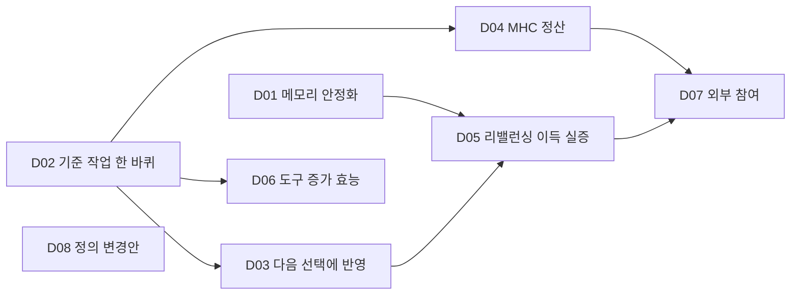

# 입운구 개발 순서 계획

2026-11-10 · SECONDARY_AI 설계(Claude). 독자: 사용자와 OMC 작업을 시작하는 담당자.
**계획 그래프와 검사·조회만 만들었다. D01–D08은 모두 PLANNED이며 구현·운영·효과를 뜻하지 않는다.**

사용자 요청: “파편화 된거 묶어주고 어케 그 개발을 진행해야할지 감좀 잡아줄수 있겟냐 ㅇㅇ?”,
“일단 작업 계획 표준그래프 엔지니어링으로 계획 수립해줘봐봐 ㅇㅇ”.
[정의 색인](WHAT_IS.md#정의-색인)의 기술 요소를 한 바퀴의 순환으로 읽고 순서를 정했다:
**요청 → 자원 선택 → 배치·실행 → 결과 검증 → MHC 정산 → 다음 선택에 반영.**

## 기존 계획을 다시 만들지 않는다

순환의 앞 절반은 이미 계획이 있다. 이 계획은 그 작업 UID를 참조만 하고 세부 단계·담당·예산은 원 계획을 따른다.

| 이 계획 | 맡기는 곳 |
|---|---|
| D01 장비 메모리 안정화 | [메모리 복구 계획](MEMORY_RECOVERY_PLAN.md)의 시작 작업 w01·w02·w16 |
| D02 기준 작업 한 바퀴 | [작업 이동 계획](WORKLOAD_MOBILITY_PLAN.md) W01–W08 |
| D03 실측을 다음 선택에 반영 | 작업 이동 계획 W09 |

기준 작업은 작업 이동 계획이 이미 고른 **HOH 합성 검증**을 기본값으로 둔다. 사용자가 다른 반복 작업을 지정하면 바꾼다.

## 순서

| ID | 담당 | 작업 | 선행 | 옮기는 정의 요소 | 종류 |
|---|---|---|---|---|---|
| D01 | OMC | 장비 메모리 안정화 | 없음 | 운영 기반 | 기존 계획 |
| D02 | OMC | 기준 작업 한 바퀴: 준비→선택→배치·실행→검증·회수 | 없음 | agent cloud, 자원 선택, 배치·실행 | 기존 계획 |
| D03 | OMC | 실측을 다음 선택에 반영 | D02 | 반영, 자원 선택 | 기존 계획 |
| D04 | MHC | 같은 작업의 MHC 정산 연결 | D02 | 정산, 참여 | 새 작업 |
| D05 | OMC | 리밸런싱·하드웨어별 실행 변형의 이득 실증 | D01, D03 | 리밸런싱, 하드웨어 네이티브, 배치·실행 | 새 작업, 측정 |
| D06 | OMC | 도구 증가 효능 4조건 비교 | D02 | 도구 증가 | 새 작업, 측정 |
| D07 | OMC | 외부 참여자의 기여·이용 경로 | D04, D05 | 참여 | 새 작업, 사용자 결정 필요 |
| D08 | OMC | 정의를 KG와 모듈 선언에 반영하는 변경안 | 없음 | 정체성 | 새 작업, 사용자 결정 필요 |



D01·D02·D08은 선행이 없어 함께 시작할 수 있다. D05와 D06은 사전에 정한 문턱으로 판정하며,
이득이 없다는 결과도 완료로 남긴다. D04는 시험용 크레딧만 쓰고 실제 결제는 범위 밖이다.

정의 요소 가운데 **철학적 OMC**와 **디멘션 워커가 보는 OMC**는 어떤 작업에도 연결하지 않았다.
앞의 것은 개발 대상이 아니고, 뒤의 것은 사용자가 아직 내용을 밝히지 않았다.

## 사용자 결정이 필요한 곳

- D07: 어떤 기기·사람까지 참여시키고 무엇을 밖에 공개할지.
- D08: 정의들이 공존인지 대체인지, 변경안을 KG에 올릴지.

## 역할 경계

사용자 결정(2026-11-11): “명확하게 역할구분 드가자”. 각 작업은 **자기 담당 저장소의 파일만 고친다.**
다른 쪽이 필요한 것은 요구·합격 기준이나 산출물로 넘기고, 상대 저장소를 직접 고치지 않는다.

| 역할 | 맡는 일 | 맡지 않는 일 | 저장소 |
|---|---|---|---|
| 입운구(OMC) | 노드 준비·관측, 자원 선택·배정·예약, worker 실행·입력 전달·결과 회수, 상태·재시도·반납, 실측 반영 | HOH 검증 묶음·합격 기준, HOH 릴리스·화면, MHC 지급 규칙 | 이 저장소 |
| HOH | 검증 묶음·테스트 식별자, 합격 기준, 자기 릴리스·공개 되읽기, 개인 관측·기여 화면 | 실행 노드 선택·배정·예약, OMC worker·전달·회수·재시도 경로 | `../HOH` |
| MHC | 검증된 결과의 견적·계약·지급·반납 | OMC 배정·실행 경로, 사용률만으로 지급 | `../metahumocoin` |
| chatgpt-api | 브라우저 탭·요청 수명과 그 API | OMC 운영 주기, HOH 화면 | `../chatgpt-api` |
| ORCA_SETTING | 저장소 가드·캐시 크레딧 | OMC 배정·실행 경로 | `../ORCA_SETTING` |

예를 들어 HOH 검증을 다른 노드에서 돌릴 때 HOH는 검증 묶음과 합격 기준(작업 이동 계획 W02)만 정하고,
어느 노드에서 어떻게 돌릴지(W01·W03–W06)는 입운구가 정한다. D04 정산도 입운구 실행 기록을
D02 산출물로 받으며 입운구 경로를 고치지 않는다.

`check`는 이 경계를 두 군데서 확인한다. 이 계획의 작업은 대상 경로가 담당 저장소 안에 있어야 한다.
위임한 두 계획(메모리·작업 이동)의 작업 29개는 대상 경로 20개가 모두 한 역할에 속하고, 그 역할이
작업 담당자와 같아야 한다. 협력자(collaborator)는 의견을 내는 쪽이라 고칠 수 있는 경로를 넓히지 않는다.
경로 소유 표는 `RoleBoundary` 노드의 `ownsPaths`이며, 각 경로가 그 저장소에 실제로 있는지도 확인한다.

## 그래프 계약

정본은 [graph/development-plan.jsonld](../graph/development-plan.jsonld)다. 기존 memory-plan/v1의 Plan, WorkItem, Owner,
SourceArtifact, OutputContract, AcceptanceCriterion, CompetencyQuestion과 OMC·HOH owner UID를 재사용한다.
새 development-plan/v1 어휘는 아래 셋과 그 속성에 한정한다.

| 새 유형·관계 | 방향·기수 | 의미 |
|---|---|---|
| DefinitionElement | — | 정의 색인의 한 요소. 사용자 원문에서 도출한 AI 배치이며 원문 자체가 아님 |
| ExistingWork | — | 다른 계획의 작업 UID를 문자열로 가리키는 참조. sameAs가 아니며 정체성을 합치지 않음 |
| RoleBoundary | Owner당 정확히 1 | 그 담당의 맡는 일·맡지 않는 일·저장소 위치와 소유 경로. 사용자 결정을 근거로 가짐 |
| realizes | WorkItem → DefinitionElement, 1..N | 그 정의를 실제 동작으로 옮기는 데 기여. 완료 증명이 아님 |
| delegatesTo | WorkItem → ExistingWork, 0..N | 이 작업의 수행을 기존 계획에 맡김 |
| dependsOn | WorkItem → WorkItem, 0..N | 후속 → 선행. 이 관계만 DAG |

사용자 원문은 바이트 해시로 고정하거나 인용으로 담고 `USER_PRIMARY`로 둔다. 사용자 인용이 섞인 기록과
설계 문서는 `SECONDARY_AI`이며 문서는 경로만 확인한다. 다른 계획 그래프는 해시로 묶지 않고,
참조한 계획과 작업 UID가 지금도 그 그래프에 있는지만 확인한다. 그래서 원 계획의 단계가 바뀌어도
이 계획은 깨지지 않지만, 참조한 작업이 사라지면 검사가 실패한다.

## 조회와 검사

```sh
python3 scripts/development_plan.py check
python3 scripts/development_plan.py query next        # 지금 시작할 수 있는 작업
python3 scripts/development_plan.py query unrealized  # 작업에 연결하지 않은 정의 요소
python3 scripts/development_plan.py show d05
```

나머지 질의는 delegated, new, decision, effect, rebalancing, settlement다. `scripts/development_plan.py`는
check/query/show/export만 제공하며 작업을 시작하지 않는다. 기존 인역강 graph-engineering의 잠긴 Python 환경을 재사용한다.

검사 범위: 84개 노드·831 triples, 실제 SHACL(작업 8·정의 요소 13·기존 작업 참조 3·역할 5), SPARQL 8개 질문의 정확한 UID 답,
고정 원문 13개의 바이트 대조, 위임한 작업 UID 12개의 존재 확인, 위임한 계획의 작업 29개·경로 20개의 역할 경계. 회귀 12개는
`python -B -m unittest tests.test_development_plan`으로 실행하며 순환·뒤집힌 관계·권위 승격·근거 없는 완료·
정의 누락·없는 위임 대상·바뀐 원문·틀린 질의 답·빈 SHACL 대상, 그리고 HOH가 입운구 경로를 맡거나
입운구가 HOH 경로를 고치는 경우, 주인 없는 경로, 두 역할이 겹치는 경로, 사용자 결정 없는 역할 정의를 거절한다.
이는 계획의 구조와 출처 검사이며 순서가 옳다는 증명이나 실행 결과가 아니다.
