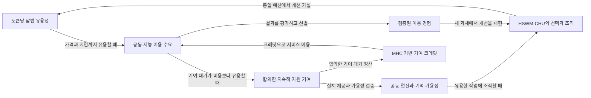

# 입체운행구름 플라이휠 그래프

동일 모델과 총토큰에서 더 유용한 답변을 얻는다는 전제로 연결한 조건부 순환이다.
모든 화살표는 SECONDARY_AI 설계 가설이며 성능·경제 효과는 미검증이다.

## 원문에서 평가까지

| 가설 | 검증할 내용 | 상태 |
|---|---|---|
| 동일 모델과 총토큰 예산에서 HSWM·CHU의 답변 효용이 단독 사용보다 높다 | 원문을 실험 가능한 전제로 정식화한 가설. 과제별 우위를 검증하며 초지능 입증을 뜻하지 않는다. | HYPOTHESIS |
| 유용한 공동 지능의 수요가 합의한 자원 기여를 유도한다 | 서비스 가치가 가격·지연·기여 비용을 고려한 대안보다 유용해야 한다. | HYPOTHESIS |
| 검증된 기여가 가용 풀과 유용한 조직 능력을 확장한다 | 실제 사용 가능한 자원과 조직 개선이 늘어야 하며 공칭 하드웨어 수만 세지 않는다. | HYPOTHESIS |
| 검증된 이용 경험이 다음 질의의 조직과 효용을 개선한다 | 정답 누출·오염·반복 오류를 배제하고 별도 과제에서 재현해야 한다. | HYPOTHESIS |
| MHC 기반 크레딧이 검증된 기여 대가와 공동 지능 소비를 연결한다 | 자원 단위·기여 검증·정산 및 서비스 제공 조건이 필요하다. MHC와 크레딧의 비율은 미정이다. | HYPOTHESIS |

[설계와 총토큰 회계](FLYWHEEL.md) · [그래프 정본](../graph/flywheel.json) · [관계 계약](../graph/flywheel-contract.json)

이 그림은 `python3 scripts/flywheel.py render`로 생성한다. 원문을 바꾸면 해시와 그래프를 함께 갱신한다.
