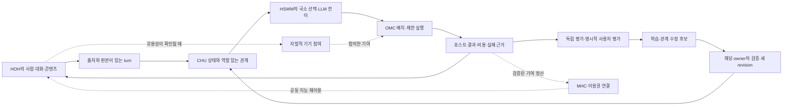

# HOW_TO — HOH 채팅에서 시작하는 OMC·CHU·HSWM 플라이휠

2026-10-11 · SECONDARY_AI / PROPOSED · **계획과 그래프 구축**. 실제 모델 호출·CHU admission·HSWM 학습·원격 기기 등록·코인 발행을 이번에 실행하지 않았다.

사용자의 방향은 두 가지다. **장기적으로 HOH를 통해 기기가 Foundation·OMC의 참여 노드가 된다. 지금은 플라이휠을 먼저 만들며, HOH 채팅 자체도 OMC 기반의 CHU·HSWM이어야 한다.** [장기 방향 원문](../records/2026-10-11/hoh-chat-flywheel/user-direction.txt)과 [이번 요청 원문](../records/2026-10-11/hoh-chat-flywheel/user-request.txt)을 그대로 보존했다. 아래 역할·계약·단계·실험 선택은 AI 설계이며 사용자의 추가 정전으로 승격하지 않는다.

## 먼저 돌아야 할 것

첫 제품 단위는 **하나의 HOH 대화가 실행 가능한 의도를 만들고, 결과가 다음 대화에서 사용할 상태와 선택을 바꾸는 과정**이다. 사용자에게는 같은 콘텐츠·대화·경험이 이어지고, 내부에서는 어떤 원문·관계·실행·결과가 변화를 만들었는지 추적할 수 있어야 한다.

HOH를 장기적으로 가판대에 비유하면 사람은 지능·게임·콘텐츠를 만나고, 기기는 자기 능력에 맞는 일을 제공한다. 첫 단계의 가치가 확인되기 전에 모든 기기 참여와 경제 제도를 한꺼번에 운영할 필요는 없다. 초기의 기억·모델·실행 장비는 명시적인 초기 공급으로 기록한다. 이 비용을 이미 돌아가는 플라이휠의 수익으로 계산하지 않는다.

세 순환을 서로 다른 시간 규모로 구분한다.

| 순환 | 닫혀야 하는 연결 | 처음 확인할 것 |
|---|---|---|
| 대화·실행, 매 turn | 요청 → 상태·문맥 → HSWM 선택·전이 → OMC 실행 → HOH 결과 | 실제 동일 turn과 상태 판본을 따라 끝까지 연결되는가 |
| 경험·개선, 여러 과업 | 귀속된 결과 → 평가 → 수정 후보 → owner 적용 → 다음 선택 | 저장된 평가가 다음 실행에 소비되는가; 새 과업에서 효용도 개선되는가 |
| 참여·경제, 장기 | 유용성 → 재이용 → 기여 → 실제 가용성·대가 → 지능 이용 | 기여 비용을 포함해 자발적 참여와 유용한 공급이 이어지는가 |

단순히 로그가 늘거나 선택이 달라지는 것은 두 번째 순환의 효용 증거가 아니다. 첫 번째의 연결 성공, 두 번째의 개선 효과, 세 번째의 지속 가능성을 각각 평가한다. 기존 [동일 모델·총토큰 플라이휠](FLYWHEEL.md)의 전제와 비용 회계를 그대로 잇는다.

화살표는 제안한 연결이고 성공 관측이 아니다. 순환 관계는 허용하며, 구현 선행 조건만 DAG로 검사한다.

## 채팅 자체가 CHU·HSWM이라는 요구의 구현 의미

HOH의 UI와 계정·콘텐츠 접근은 HOH가 소유한다. 대화의 지속 상태와 실행 가능한 관계는 CHU의 소유 스키마에 맞는 표현으로 연결하고, 그 관계가 HSWM의 읽기·선택·국소 LLM 연산·상태 전이를 실제로 조건화하도록 설계한다. OMC는 이 전이를 실현할 하드웨어·프로그램·데이터 위치를 맡는다. 각각 별도 외부 AI를 호출하는 메뉴라는 모델로 관계를 고정하지 않는다.

CHU를 JSON 조각이나 메모리 저장소라는 뜻으로 축소하지 않는다. HSWM 소유 원문은 지능적 존재로서의 CHU와 그 지능의 구조인 HSWM을 구분한다. 이 설계의 저장·전이 계약은 그 목표를 실현하기 위한 제한된 첫 구현이며 CHU 전체의 정의가 아니다. 사용자 정전에서 폐기한 H/W/A/F/Π 고정 분해도 다시 도입하지 않는다.

첫 구현의 다음 조건이 모두 충족돼야 **HOH의 제한된 채팅 경로가 실제 CHU·HSWM 기반으로 연결됐다**고 부른다.

1. turn이 단순 메시지 문자열 외에 선택한 CHU 상태 판본, 관계의 역할·문맥·출처와 결속된다.
2. HSWM이 그 상태를 읽어 선택한 관계와 입력을 실행 전에 기록하며 실제 국소 LLM 전이를 수행한다.
3. OMC의 실행 요청과 호스트 결과가 같은 attempt에 결속된다. 데이터 복사 CLI 성공을 인지 실행으로 세지 않는다.
4. 다음 turn은 정확한 승인 상태 판본을 다시 읽는다. 세션별 격리·취소·재시작에도 이 계보를 보존한다.
5. 학습이 켜진 경우 별도 평가를 거친 수정과 그 적용 영수증이 다음 선택에 연결된다. 동결 모드는 상태·행동 관측을 유지하면서 학습을 멈춘다.

일부 조건만 충족했다면 `ADAPTER_TESTED`, `STATE_CONNECTED`, `INFERENCE_CONNECTED`, `FEEDBACK_CONNECTED`처럼 실제 범위를 표시한다. `EFFICACY_SUPPORTED`는 별도 비교 실험 결과가 있을 때만 붙인다. 이 상태 이름은 제안한 제품 관측 차원이며 현재 API의 필드나 이미 부여된 등급은 아니다.

## 소유와 변경 경계

| 책임 | 제안한 담당 | 구체적 경계 |
|---|---|---|
| 사람·세션·콘텐츠·메시지의 접근 범위 | HOH | 인증된 actor와 접근 가능한 콘텐츠 snapshot을 결정; 모델이 actor·권한을 생성하지 않음 |
| 지속 상태·관계 표현과 admission | CHU 소유 계약, HSWM의 실제 호스트 | 안정 identity·content digest·revision을 분리; 승인된 atom version의 책임 owner 하나를 보존 |
| 읽을 문맥·역할 조합·LLM 전이·결과 학습 | HSWM | 국소 관계와 실패·기권을 기록; native 실행기의 한계 안에서 시작 |
| 하드웨어 관측·프로그램 변형·예약·실행·데이터 위치 | OMC | 의미와 작업 계약을 보존한 physical realization; 리소스 관측과 확보를 구분 |
| 콘텐츠 명령 실행 사실과 사용자 평가 | HOH의 host + 분리된 evaluator | 상태 변경 receipt, 명시적 평가, 모델 추정을 다른 근거로 기록 |
| 참여·기여·정산의 공통 규칙 | Foundation·기존 MHC 소유 연구 | 자원 제공 의사, 실제 제공, 보상 자격·사용을 구분; 이번 계획으로 발행 규칙 확정 안 함 |

이것은 저장소 간 구현 인계안이다. HOH·HSWM·CHU·Foundation의 기존 writer를 OMC로 옮기지 않는다. HOH의 콘텐츠 상태와 HSWM의 인지 상태가 같은 사실을 가리킬 때, 각 상태의 소유자가 발급한 revision을 참조하고 권위 있는 원본을 두 개 만들지 않는다.

**배치와 학습의 두 변경을 분리한다.** OMC 배치 변경은 의미 그래프 Gᵥ를 고정하고 물리 위치 Rₜ를 바꾼다. HSWM 학습은 출처가 있는 제안과 owner 적용으로 Gᵥ→Gᵥ₊₁을 만든다. 학습 중에는 해당 revision으로 배치 계획을 다시 검증할 수 있지만, 파일 이동이 의미를 바꾸거나 학습이 이동 완료 기록을 덮는 경로는 두지 않는다.

## 현재 구현에서 이어갈 위치

[기존 구현 조사](HOH_CHAT_FLYWHEEL_SOURCE_REVIEW.md)와 [핀 목록](../records/2026-10-11/hoh-chat-flywheel/sources.json)에 실제 읽은 원문·코드·Git 판본·SHA-256이 있다.

- HOH `Chat.ts`의 콘텐츠 명령, 상태 충돌 검사, host 확인·취소 경로를 보존한다. 일반 대화의 `ContentPlanner.plan(message, view)`는 현재 턴 입력과 선택 콘텐츠를 받는다. 지속 대화·인지 trace·실행 예산·학습 결과까지 전달하는 새 경계가 필요하다.
- `Substrate.ts`의 content bytes·ordered participants·snapshot hash는 시작 부품이다. 이 번들만으로 native CHU kernel admission 또는 HSWM 인지가 성립하지 않는다.
- HSWM의 기존 국소 실행·결과 기록·revision 부품과 `core-learning` 설계를 재사용한다. 선택 trace와 독립 outcome을 매핑하고, 적용된 새 revision을 다음 선택기가 소비하는 연결이 필요하다. scalar 선택의 국소 학습을 HSWM 전체 의미 학습으로 승격하지 않는다.
- OMC의 현재 bounded CLI는 데이터 배치 경로다. 채팅 계산을 실제 장비에서 수행하는 `WorkloadIntent → reservation → run → verified outcome` adapter는 별도 구현 단위다. 첫 연결은 한 소유 영역·한 등록 호스트에서도 가능하며 다중 기기 실행 성능을 주장하지 않는다.

제품 코드 변경 전에는 각 저장소의 현재 판본과 계약을 다시 읽는다. 이번 정적 조사 이후 동시 개발이 진행될 수 있으므로 본 문서의 파일 관측을 라이브 서비스 상태라고 표시하지 않는다.

## 첫 수직 구현: 같은 콘텐츠에서 관찰·행동·결과·다음 대화

첫 과제 후보는 **HOH 체크리스트에서 현재 항목을 읽고, 요청한 항목 하나를 완료하고, 다음 대화에서 남은 항목을 설명하는 것**이다. 현재 host가 검증할 수 있는 상태 전이가 있어 답변 문장과 실제 효과를 구별할 수 있다. 일반 질문 응답·게임·버튜버로의 확장은 이후 같은 계약으로 진행한다. 단순 체크리스트 성공은 일반 지능의 증거가 아니다.

예: turn 1에서 “남은 일 하나를 끝내줘”를 해석한다. 명확하지 않으면 기권하거나 대화로 대상을 좁힌다. 대상이 정해지면 기존 HOH의 쓰기 확인 계약을 따른다. 사람이 확인한 효과만 host가 수행하고, 상태 판본이 달라졌으면 재관찰한다. turn 2의 “이제 뭐가 남았지?”는 방금 실행한 결과 판본을 읽어 답한다. 정정·취소·실행 불명도 같은 이력에 남긴다.

이 단계의 상태 반영은 학습과 구분한다. 완료 항목을 다음 답변에 반영하는 것은 상태 읽기다. 실패한 문맥 선택을 독립 평가하여 정책을 수정하고, 별도 과업에서도 더 나은 선택을 하는지를 확인하는 것이 학습 평가다.

### 제안한 최소 계약

아래는 구현용 초안 필드이며 native CHU/HSWM wire schema로 확정한 것이 아니다. 각 owner의 schema·reader·writer에 대응한 후 버전을 고정한다.

| 계약 | 반드시 보존할 내용 |
|---|---|
| TurnEnvelope | turnId, conversationId, parentTurnId, authenticated actorRef, requestId, messageRef·revision, contentRef·revision, purpose, permittedScope, budget, cancelRef |
| ContextFrame | CHU/state revision, schemaRef, 원래 content descriptor와 해시, relationId, ordered participant occurrences(role·index·memberRef), 필수 근거·예외, 읽기 범위 |
| SelectionTrace | turnId/attemptId, 선택 전 state/policy/model revision, 후보 집합·선별 사유, 실제 선택, 선택기 점수와 실제 logging probability의 별도 값, 예상 비용 |
| WorkloadIntent | traceRef, 작업 의미·입출력·effect 계약, variant digest, 입력 revision, 허용 호스트, deadline·자원 한도, idempotencyKey, reservation/fence 세대 |
| ExecutionReceipt | runId·attemptId·intentRef, 실행기·호스트 관측, 시작/종료·취소/UNKNOWN, input/output digest, 전후 상태 revision, 실제 토큰·컴퓨팅·지연·전송 비용 |
| OutcomeAssessment | receiptRef, 평가 계약 판본, 평가자·평가 원문, 독립 정답/상태 근거, utility와 success, 불확실성·누락, 사용자 만족도와 task success의 분리 |
| RevisionProposal | outcomeRef, target atom/policy·기준 revision·책임 owner, 변경 범위·근거·가설, 평가 자료의 train/holdout 구분, 필요시 반례 |
| RevisionApplication | proposalRef, owner 결정, previous/new revision, apply receipt, conflict/rejection, restore lineage; 적용과 다음 사용을 구분 |
| NextTurnEvidence | parent outcome, 실제 읽은 새 revision, next selection trace, 동결 기준선과 비교 가능한 과업 family |
| ContributionRecord | 장기 단계: 제공 약속, 실제 수행 receipt, 중복 배제, 적용 규칙 판본, 검증된 기여량, 정산 결정·소비 receipt; pending와 settled 분리 |

하나의 TurnRelation은 요청·문맥·선택·실행·결과·평가·수정·다음 선택의 역할을 가진 n항 관계로 표현한다. 같은 member가 다른 역할로 두 번 등장할 수 있으므로 member 집합으로 중복 제거하지 않는다. 순서와 occurrence ID를 보존한다. 계획 그래프의 이 관계는 **계약 연결 template**이며 실행된 turn 사례가 아니다.

메시지와 요청은 append-only 사건으로 시작하고 수정은 새 판본으로 기록한다. durable receipt를 만들기 전에 UI에서 응답이 끊겨도 같은 requestId의 실행 여부를 조회할 수 있어야 한다. UNKNOWN은 실패나 성공으로 자동 변환하지 않는다. 이미 확정된 효과는 모델을 다시 호출해 추측해서 재실행하지 않는다.

## 경험을 다음 선택으로 돌려보내기

첫 학습 연결은 **관계 원문을 고정한 활성화 정책의 제한된 개선**부터 시작한다. 원문·역할·예외가 보존된 후보 묶음 중 무엇을 읽고 실행할지 비교하고, 승인된 정책 revision이 다음 선택에 쓰였는지 확인한다. 이후 관계의 의미·전이 성향 자체를 수정하는 연구로 넓힌다. 전체 조합의 결과를 모든 구성 관계의 단독 공로로 복제하지 않는다.

추천 점수, LLM confidence, 실제 행동 선택 확률, 평가 효용, 변경 권한은 서로 다른 값이다. HTTP 200, 답변 생성, 모델의 “완료” 문장, 클릭 수만으로 학습 보상을 만들지 않는다. 좋아요·만족도는 출처 있는 사용자 관측이지만 객관적 정답 또는 실제 실행 receipt를 대신하지 않는다.

HOH 추천과 채팅의 경험은 같은 결과 참조를 사용할 수 있으나 목표는 다르다. 콘텐츠 추천은 무엇이 유용했는지, 채팅은 어떤 문맥·전이가 과업을 해결했는지, OMC는 어떤 물리 실행이 비용·지연·정확성 조건을 충족했는지 평가한다. 세 정책을 한 숫자의 W로 합치지 않는다.

개인의 기억은 기본적으로 개인 범위의 상태로 설계한다. 공유 경험 후보에는 목적·권한·출처·철회 조건을 붙이고, 채택 이후에도 원문과 AI 추론을 구분한다. 정정된 사용자 사실, 추정 선호, 실패 사례의 유효 기간이 다를 수 있다. 오래되거나 철회된 자료를 다음 문맥에서 제외하는 경로까지 필요하다.

## 단계별 계획과 완료 기준

| ID | 담당·순서 | 만들 것 | 완료를 주장할 근거 |
|---|---|---|---|
| F0 | HOH · 먼저 | TurnEnvelope, 요청·관찰·효과·평가 사건 저장 | 계정 격리, 중복 요청, 재시작, 오래된 상태, 취소/UNKNOWN의 정확한 readback |
| F1 | CHU owner/HOH adapter · F0 뒤 | 역할 있는 세션·콘텐츠 상태 표현과 native owner admission 매핑 | 원문 바이트·역할·판본 보존, 불허 상태 거절, 정확한 새 상태 재조회 |
| F2 | HSWM · F1 뒤 | CognitiveTurnPort, native 선택·국소 LLM 전이와 trace mapper | 모델 스텁과 실제 호출의 구분, 독립 turn trace, 필요한 예외·역할 보존 |
| F3 | OMC · F0 뒤 | 제한된 작업 계약·호스트 예약·실행 adapter | 한 등록 호스트의 실제 실행·결과·비용·중복/중단 복구; 의미와 위치 분리 |
| F4 | HSWM + HOH evaluator · F2/F3 뒤 | receipt→outcome→수정 후보→owner 적용→다음 선택 연결 | 새 revision이 다음 turn에 소비됨, 중복 학습 거절, 동결/복원 비교 |
| F5 | OMC 연구 · F4 뒤 | 동일 예산·자료·과업의 효용 비교 | 성공률·효용·실제 총비용·불명·퇴행을 포함한 별도 holdout 결과 |
| F6 | OMC + HOH · F3/F5 뒤 | 장기 기기 참여 가판대·capability/lease·기여 관측 | 참여/중단·변동 가용량·복수 장비에서 같은 의미의 작업·기여 검증 |
| F7 | Foundation/MHC owner · F5/F6 뒤 | 기여 인정→대가→지능 이용의 제한된 정산 | 중복·무효 기여 배제, 제공된 서비스와 기여 비용, 재이용·이탈·복구 관측 |

F0–F4는 첫 닫힌 기술 순환, F5는 그 순환이 실제로 도움이 되는지의 검사, F6–F7은 검증된 범위의 확대다. 모든 F 항목은 지금 `PLANNED`다. 문서·그래프 검증을 이 표의 구현 완료로 세지 않는다. 다음 코딩 시작점은 **HOH의 durable turn/outcome 계약(F0)**이며 기존 `Chat.ts`·host store의 권한과 실행 판정 경계를 보존한다.

## 무엇과 비교할 것인가

기존 A 단독 LLM, B 동일 자료의 일반 검색, C CHU·HSWM 조직 비교를 유지한다. C는 초기 상태를 고정한 C-frozen과 train 경험을 반영한 C-updated로 나누어 **연결 효용과 학습의 추가 효용**을 구분한다. 학습 전후를 다른 문제 집합의 평균만으로 비교하지 않는다.

모델·tokenizer·자료 접근 범위·후보·과업 family·평가 계약·자원 상한을 고정한다. train과 held-out task family를 실행 전에 나누고 재시도를 독립 표본으로 세지 않는다. 외부 자료가 없는 A와 B/C의 차이, 같은 자료인 B와 C의 차이를 별도로 해석한다. 모든 내부 호출·재시도·실패·검증·요약의 입력/출력 토큰을 합산하고 공급자 토큰 정의를 명시한다. 사전 기억 구축 비용은 별도 총량·상각량으로 남긴다.

평가 manifest에는 표본 수·seed·평가 시간창·최소 개선폭·추정 방법·허용 퇴행·지연 상한을 결과를 보기 전에 고정한다. 이번에는 실제 모델/예산을 선택하거나 품질 숫자를 채우지 않았다. 계약 반례 검사는 소규모 fixture로 먼저 할 수 있지만 품질·참여 가설의 검증으로 승격하지 않는다.

반드시 포함할 실패 사례: 동일 요청의 재전송, 결과 저장 전 중단, 취소와 완료의 경합, 갱신 중 콘텐츠 수정, 잘못된 actor, 철회된 자료, 근거 없이 생성한 완료, 모호한 평가, train/test 누출, 지원 없는 반사실 행동, 오래된 정책의 결과 제출, 한 장비의 이탈. timeout만 보고 재실행하지 않고 실행 사실을 확인한다.

## 그래프와 재개 방법

[설계 그래프](../graph/hoh-chat-flywheel.json)는 사용자 근거→요구 해석→계약·작업→평가를 연결한다. 기존 OMC/HSWM/HOH·플라이휠 단계 UID를 재사용하고 기존 원문은 고정 사본으로 참조한다. [관계 계약](../graph/hoh-chat-flywheel-contract.json)에 domain/range·방향·기수·역할·상태·선행 DAG와 허용 순환을 명시했다. 출처 검사는 실제 바이트 해시를 읽고 CQ는 정확한 UID·근거 사슬을 비교한다.

`python3 records/2026-10-11/hoh-chat-flywheel/validate.py`로 검사한다. 이 형식은 OMC 소유의 property graph이며 공유 KG 정전 쓰기·RDF/SHACL 적합성·native CHU 실행 완료를 뜻하지 않는다. 기존 연구 허브의 HOW_TO workflow로 원문과 설계 그래프를 보존하며 실제 실행은 해당 owner의 별도 구현·검증 결과로 누적한다.

수정 시 원문을 덮지 말고 새 해석·계약 판본을 남긴다. 설계 되돌리기는 이번 문서·그래프·안내의 additive commit을 revert하는 범위다. 향후 runtime 복원은 상태 삭제가 아니라 owner의 이전 의미를 새 revision으로 복원하는 계약을 따른다.
