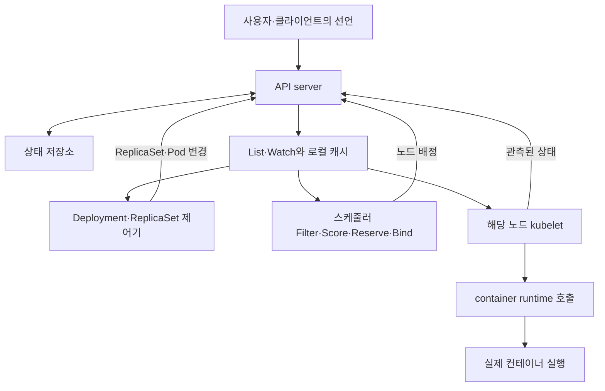

# 쿠버네티스 코드로 읽는 조정과 실행 원리

쿠버네티스의 핵심은 **원하는 상태를 API 객체로 저장하고, 여러 제어기가 관측한 상태와 비교하여 작업을 나누어 수행하는 구조**다. 스케줄러는 실행할 노드를 선택하고 배정을 확정하는 경로를 담당하며, 노드의 kubelet과 container runtime이 실제 실행을 맡는다. 요청 접수·배정 성공·프로그램 실행·애플리케이션 준비 완료는 서로 다른 사실이다.

분석 대상은 공식 `kubernetes/kubernetes`의 [`841d8db7236e660f53ee9df91133b58a780c8e7f`](https://github.com/kubernetes/kubernetes/commit/841d8db7236e660f53ee9df91133b58a780c8e7f)다. 2026-10-07에 확보한 master snapshot을 재사용했으며 최신 안정판 선정이 아니다. 이번에는 선택한 27개 파일 약 1.31 MB를 [로컬 소스 사본](../records/2026-10-10/post-client-server-kubernetes/upstream)에 가져와 Git blob과 대조했고, 그중 3개 파일은 공식 원격의 같은 commit에서 다시 받아 바이트까지 대조했다. 기존 전체 소스 archive의 SHA-256도 다시 확인했다. [확보 기록](../records/2026-10-10/post-client-server-kubernetes/acquisition.json).

아래는 선택 구간의 정적 코드 분석이다. 전체 소스 정독, 쿠버네티스 빌드·테스트·클러스터 실행·성능 실험은 수행하지 않았다. 코드 저작권과 Apache 2.0 [LICENSE](../records/2026-10-10/post-client-server-kubernetes/upstream/LICENSE)를 사본에 보존했다. 기존 WHAT_IS_KUBERNETES의 Deployment 중심 연구에서 API·스케줄러·노드 실행·장비 제약으로 분석 범위를 확장했다.

## 한 작업이 실행되는 경로

이 그림은 읽은 코드에 근거한 책임 관계의 설명이다. 동기 함수 호출 한 줄이나 전역 원자 트랜잭션으로 해석하지 않는다. 각 구성은 별도 시점의 관측과 실패를 가진다. C01–C15의 근거 구간과 파일 digest는 [evidence.json](../records/2026-10-10/post-client-server-kubernetes/evidence.json)에 연결했다.

## C01과 C02 요청과 상태 변경

`DefaultBuildHandlerChain`은 인증·권한·감사·요청 제한 등의 handler를 조합한다. wrapper가 바깥에서 감싸지는 구조이므로 나열 순서를 그대로 요청 실행 순서로 읽으면 안 된다. 이 경계는 누가 어떤 변경을 요구할 수 있는지와 요청 처리 부담을 다룬다. [config.go 1036–1086](https://github.com/kubernetes/kubernetes/blob/841d8db7236e660f53ee9df91133b58a780c8e7f/staging/src/k8s.io/apiserver/pkg/server/config.go#L1036-L1086).

API registry의 조건부 update 분기는 `resourceVersion`이 없거나 최신 버전과 다르면 오류 또는 Conflict를 반환한다. 같은 함수의 unconditional update 경로는 별도이므로 “모든 변경이 같은 조건을 요구한다”고 일반화하지 않는다. etcd storage의 `GuaranteedUpdate`는 현재 revision을 이용해 `OptimisticPut`을 시도하고 충돌 시 상태를 다시 얻어 반복한다. API 객체 하나의 동시성 계약을 여러 장비의 실행·데이터 이동·보상 정산 전체가 원자적이라는 뜻으로 확장할 수는 없다. [registry store 878–908](https://github.com/kubernetes/kubernetes/blob/841d8db7236e660f53ee9df91133b58a780c8e7f/staging/src/k8s.io/apiserver/pkg/registry/generic/registry/store.go#L878-L908), [etcd store 620–650](https://github.com/kubernetes/kubernetes/blob/841d8db7236e660f53ee9df91133b58a780c8e7f/staging/src/k8s.io/apiserver/pkg/storage/etcd3/store.go#L620-L650).

**OMC 적용 제안:** 사용자 의미 계약의 revision, 관측 상태의 generation, 실행 artifact digest를 따로 기록한다. 자원 선택 당시의 상태가 실행 전까지 유효한지 검사하며, 충돌하면 새 상태로 재계획한다. 해당 버전 토큰을 HSWM 영구 ID나 모든 장비의 공통 시계로 쓰지 않는다.

## C03 관측은 캐시이며 명령 원장이 아니다

`Reflector.ListAndWatchWithContext`는 이 판본에서 WatchList 경로를 시도할 수 있고, 사용할 수 없으면 일반 list로 초기 상태를 채운 뒤 watch와 resync로 이어간다. 따라서 동작을 설명할 때 “언제나 LIST 한 번 뒤 WATCH”라고 구현 분기를 지워서는 안 된다. downstream 제어기는 관측 캐시를 읽으며, 이것을 모든 외부 부작용의 정확히 한 번 실행 원장으로 취급할 근거는 없다. [reflector.go 463–565](https://github.com/kubernetes/kubernetes/blob/841d8db7236e660f53ee9df91133b58a780c8e7f/staging/src/k8s.io/client-go/tools/cache/reflector.go#L463-L565).

**OMC 적용 제안:** 이벤트는 다시 확인할 대상을 알려 주고, 실행 intent와 결과는 별도 내구 기록에 남긴다. 관측의 시각·만료·출처를 보존하며 오래된 캐시로 권한·가용량을 확정하지 않는다.

## C04와 C05 상태 수렴과 복제의 범위

Deployment worker는 큐에서 key를 꺼내 `syncHandler`를 호출한다. `syncDeployment`는 lister에서 객체를 다시 읽고 deep copy한 후 삭제·일시정지·스케일·배포 전략에 맞는 경로를 선택한다. 오류는 제한된 rate-limited retry로 처리하며 최대 재시도 이후 큐 항목을 잊는 경로도 있다. 계속 같은 key를 처리한다는 것과 모든 실패가 무한히 자동 복구된다는 것은 다르다. [deployment_controller.go 475–518](https://github.com/kubernetes/kubernetes/blob/841d8db7236e660f53ee9df91133b58a780c8e7f/pkg/controller/deployment/deployment_controller.go#L475-L518), [575–661](https://github.com/kubernetes/kubernetes/blob/841d8db7236e660f53ee9df91133b58a780c8e7f/pkg/controller/deployment/deployment_controller.go#L575-L661).

ReplicaSet의 `manageReplicas`는 현재 활성 Pod 수와 요청한 replica 수의 차이를 계산한다. 부족하면 해당 ReplicaSet의 Pod template으로 생성하고, 많으면 선택한 Pod를 삭제한다. 생성 요청이 아직 관측되지 않은 상태를 다루는 expectations와 대량 실패를 줄이는 slow-start도 있다. **같은 template 복제는 이 ReplicaSet의 계약**이다. 서로 다른 작업·프로그램·노드 조건까지 전부 같아야 한다는 계약은 아니다. [replica_set.go 653–750](https://github.com/kubernetes/kubernetes/blob/841d8db7236e660f53ee9df91133b58a780c8e7f/pkg/controller/replicaset/replica_set.go#L653-L750).

**OMC 적용 제안:** 반복 실행에서는 현재 계약과 상태를 다시 읽는다. “같은 의미 계약을 구현하는 서로 다른 variant”와 “같은 template의 replica”를 별도 관계로 모델링한다. 복제 수만 맞는 것으로 결과 정확성을 판정하지 않는다.

## C06부터 C08 노드 선택과 배정

이 snapshot의 `ScheduleOne`은 단일 Pod와 PodGroup 경로를 나눈다. 이번 분석은 **단일 Pod 경로**를 따라갔다. `SchedulePod`는 적격 노드를 찾고, 적격 노드가 하나면 이를 선택하며, 여러 개면 `prioritizeNodes`의 점수를 이용한다. 필터 후보 탐색에는 예산과 조기 선택 경로가 있으므로 모든 노드·모든 미래 부하에 대한 전역 최적해를 계산한다고 표현하지 않는다. [algorithm.go 144–203](https://github.com/kubernetes/kubernetes/blob/841d8db7236e660f53ee9df91133b58a780c8e7f/pkg/scheduler/algorithm.go#L144-L203), [327–387](https://github.com/kubernetes/kubernetes/blob/841d8db7236e660f53ee9df91133b58a780c8e7f/pkg/scheduler/algorithm.go#L327-L387), [schedule_one.go 565–601](https://github.com/kubernetes/kubernetes/blob/841d8db7236e660f53ee9df91133b58a780c8e7f/pkg/scheduler/schedule_one.go#L565-L601).

선택 후 `AssumeAndReserveInCache`가 캐시에 배정을 가정하고 Reserve를 수행한다. 실패하면 Unreserve와 Forget 경로가 실행된다. Permit 조건을 거쳐 binding cycle은 별도 goroutine에서 진행될 수 있다. 이 캐시의 Assume을 다른 소유 장비까지 아우르는 영속 임대 원장과 동일시하지 않는다. [algorithm.go 618–650](https://github.com/kubernetes/kubernetes/blob/841d8db7236e660f53ee9df91133b58a780c8e7f/pkg/scheduler/algorithm.go#L618-L650), [schedule_one.go 129–144](https://github.com/kubernetes/kubernetes/blob/841d8db7236e660f53ee9df91133b58a780c8e7f/pkg/scheduler/schedule_one.go#L129-L144), [200–231](https://github.com/kubernetes/kubernetes/blob/841d8db7236e660f53ee9df91133b58a780c8e7f/pkg/scheduler/schedule_one.go#L200-L231).

binding cycle은 Permit 대기, PreBind, Bind, PostBind를 구분한다. DefaultBinder는 Pod UID와 대상 Node를 가진 Binding을 작성하고 API cacher 또는 client 경로로 전달한다. 이 성공을 애플리케이션 준비 완료나 계산 결과 검증으로 기록하지 않는다. [schedule_one.go 314–427](https://github.com/kubernetes/kubernetes/blob/841d8db7236e660f53ee9df91133b58a780c8e7f/pkg/scheduler/schedule_one.go#L314-L427), [default_binder.go 52–76](https://github.com/kubernetes/kubernetes/blob/841d8db7236e660f53ee9df91133b58a780c8e7f/pkg/scheduler/framework/plugins/defaultbinder/default_binder.go#L52-L76).

**OMC 적용 제안:** `의미·호환·권한 필터 → 프로그램·장비·데이터 경로 후보 비교 → 자원 예약 → 실행 → 결과 검증`을 구별한다. AI는 후보와 이유를 만들고, 필수 제약·예약 충돌·만료를 처리하는 검사기는 독립적으로 유지한다.

## C09와 C10 노드에서 실제로 실행하기

kubelet의 API config source는 `spec.nodeName`이 자기 노드와 같은 Pod를 선택해 관측한다. kubelet의 sync loop는 설정 변경·컨테이너 이벤트·주기적 재동기화·probe 결과를 처리한다. `SyncPod`는 container runtime 동기화를 호출하고 그 결과를 기록한다. 스케줄러가 원격 프로세스를 직접 시작하는 단일 호출 구조가 아니다. [config/apiserver.go 36–67](https://github.com/kubernetes/kubernetes/blob/841d8db7236e660f53ee9df91133b58a780c8e7f/pkg/kubelet/config/apiserver.go#L36-L67), [kubelet.go 2680–2725](https://github.com/kubernetes/kubernetes/blob/841d8db7236e660f53ee9df91133b58a780c8e7f/pkg/kubelet/kubelet.go#L2680-L2725), [2759–2845](https://github.com/kubernetes/kubernetes/blob/841d8db7236e660f53ee9df91133b58a780c8e7f/pkg/kubelet/kubelet.go#L2759-L2845), [2273–2284](https://github.com/kubernetes/kubernetes/blob/841d8db7236e660f53ee9df91133b58a780c8e7f/pkg/kubelet/kubelet.go#L2273-L2284).

runtime manager는 현재 상태와 Pod 선언을 비교해 sandbox·container 변경을 계산한다. sandbox 생성 경로에는 `RunPodSandbox`, 컨테이너 시작 경로에는 `CreateContainer`와 `StartContainer` 호출이 있다. 이번 판독은 그 runtime service 경계까지이며, containerd/runc 내부까지 분석하거나 실행한 것은 아니다. [kuberuntime_manager.go 1570–1618](https://github.com/kubernetes/kubernetes/blob/841d8db7236e660f53ee9df91133b58a780c8e7f/pkg/kubelet/kuberuntime/kuberuntime_manager.go#L1570-L1618), [kuberuntime_sandbox.go 40–79](https://github.com/kubernetes/kubernetes/blob/841d8db7236e660f53ee9df91133b58a780c8e7f/pkg/kubelet/kuberuntime/kuberuntime_sandbox.go#L40-L79), [kuberuntime_container.go 270–300](https://github.com/kubernetes/kubernetes/blob/841d8db7236e660f53ee9df91133b58a780c8e7f/pkg/kubelet/kuberuntime/kuberuntime_container.go#L270-L300).

**OMC 적용 제안:** 노드의 로컬 책임과 상태 조정 원리는 재사용한다. 네이티브 프로세스 실행에는 OS별 실행·자원 제한·취소·복구 adapter를 별도로 설계한다. kubelet을 그대로 설치한 뒤 컨테이너 계약이 사라졌다고 주장하지 않는다.

## C11과 C12 하드웨어 차이를 다루는 실제 코드

NodeAffinity의 Filter는 노드 선택 조건을 검사하고 Score는 선호 조건의 점수를 계산한다. Topology Manager의 single-NUMA 정책은 적절한 단일 NUMA hint를 골라 admission 여부를 계산한다. 쿠버네티스에도 하드웨어 차이를 반영하는 명시적 경로가 있다. [node_affinity.go 212–235](https://github.com/kubernetes/kubernetes/blob/841d8db7236e660f53ee9df91133b58a780c8e7f/pkg/scheduler/framework/plugins/nodeaffinity/node_affinity.go#L212-L235), [269–298](https://github.com/kubernetes/kubernetes/blob/841d8db7236e660f53ee9df91133b58a780c8e7f/pkg/scheduler/framework/plugins/nodeaffinity/node_affinity.go#L269-L298), [policy_single_numa_node.go 41–77](https://github.com/kubernetes/kubernetes/blob/841d8db7236e660f53ee9df91133b58a780c8e7f/pkg/kubelet/cm/topologymanager/policy_single_numa_node.go#L41-L77).

`fitsRequest`의 CPU·메모리·ephemeral storage 조건은 노드 allocatable과 이미 요청된 자원량을 비교한다. 여기서 읽은 계산을 실시간 CPU 사용률·메모리 대역폭·네트워크 혼잡을 모두 측정하는 최적화기로 설명할 수는 없다. [fit.go 713–771](https://github.com/kubernetes/kubernetes/blob/841d8db7236e660f53ee9df91133b58a780c8e7f/pkg/scheduler/framework/plugins/noderesources/fit.go#L713-L771).

**OMC 적용 제안:** 선언된 capacity/request와 실제 가용량·부하 관측을 따로 유지한다. 프로그램 변형과 데이터 locality까지 선택 범위를 확장하되, 새 범위의 정확성과 성능은 별도 실험으로 입증한다.

## C13과 C14 장애와 연결 경로

Node lifecycle controller는 heartbeat와 lease 갱신 시각을 읽고 유예기간을 넘기면 조건을 Unknown으로 바꾸는 경로를 가진다. 이 snapshot에는 feature gate에 따라 오래된 lease 캐시를 재확인하는 경로도 있다. 통신이 보이지 않는다는 관측을 물리 장비가 확실히 죽었다는 증명으로 바꾸지 않는다. [node_lifecycle_controller.go 913–1014](https://github.com/kubernetes/kubernetes/blob/841d8db7236e660f53ee9df91133b58a780c8e7f/pkg/controller/nodelifecycle/node_lifecycle_controller.go#L913-L1014).

iptables proxier의 `syncProxyRules`는 Service와 endpoint 관측이 준비된 후 변경을 반영하며 실패 시 재동기화 경로를 둔다. 이는 연결 정보와 실제 전달 규칙이 별도 상태라는 예다. 이번에 읽은 것은 iptables backend의 조정 진입부이며 모든 CNI·eBPF·서비스 메시 구현을 포괄하지 않는다. [proxier.go 625–665](https://github.com/kubernetes/kubernetes/blob/841d8db7236e660f53ee9df91133b58a780c8e7f/pkg/proxy/iptables/proxier.go#L625-L665).

**OMC 적용 제안:** USL 의미 링크의 보존과 현재 물리 경로의 도달 가능성을 별도 검사한다. 단절된 실행자의 기존 작업을 무조건 중복 실행하지 말고, lease·fencing·작업의 부작용 계약에 따라 처리한다.

## C15 테스트 정의에서 배운 반례

`TestSyncDeploymentDeletionRace`는 캐시에는 객체가 살아 있고 API client에는 삭제 중인 상태를 둔다. 재확인 후 오류·재큐잉을 기대한다. 스케줄러의 `TestSchedulerScheduleOne` 일부 사례는 Reserve/Permit 실패 시 assumed Pod를 잊고 오류 또는 unschedulable 상태에 맞는 큐 처리를 기대한다. [deployment test 304–329](https://github.com/kubernetes/kubernetes/blob/841d8db7236e660f53ee9df91133b58a780c8e7f/pkg/controller/deployment/deployment_controller_test.go#L304-L329), [scheduler test 774–829](https://github.com/kubernetes/kubernetes/blob/841d8db7236e660f53ee9df91133b58a780c8e7f/pkg/scheduler/schedule_one_test.go#L774-L829).

이것은 읽은 테스트의 정의이며 **이번에 실행한 테스트 결과가 아니다**. OMC의 다음 구현에는 같은 종류의 오래된 관측·예약 실패·실행 불확실성 반례를 자체 계약에 맞춰 넣는다. 이번 로컬 검사 PASS는 출처 파일·읽기 구간·주장·지식 관계의 무결성을 뜻한다.

## OMC 설계로 이어지는 결론

OMC는 쿠버네티스에서 선언과 관측의 분리, 반복 조정, 제약과 점수의 분리, 실제 실행의 로컬 책임을 배울 수 있다. 그 위에 작업 의미·하드웨어별 프로그램 변형·데이터 배치·검증된 기여를 연결하는 계약이 필요하다. 이 확장은 [지식 및 구축 계획](POST_CLIENT_SERVER_KNOWLEDGE_PLAN.md)의 HOW_TO이며, 읽은 코드 자체가 OMC의 가능성이나 성능을 증명한 것은 아니다.
