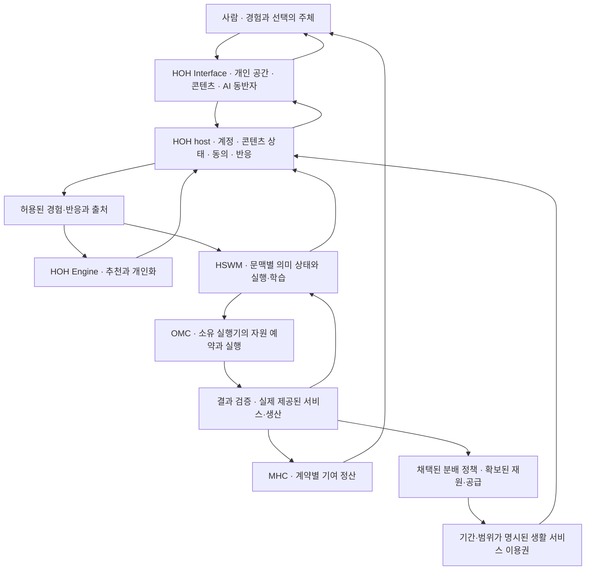

# LFM 아키텍처 — HOH에서의 삶과 AI의 발전을 잇기

2026-10-26 · v0.1 · Codex · **SECONDARY_AI / PROPOSED / 설계 완료, 구현·운영 미실행**.
독자는 HOH·Engine·Interface·HSWM·OMC·MHC 구현자다. 이 문서는 OMC에서 작성한 소유자 간 통합 설계이며 각 제품의 정본·배포·경제 정책을 변경하지 않는다.
[이번 사용자 원문과 출처 판본](../records/2026-10-26/lfm-architecture/README.md)을 설계와 구분한다.

<a id="vision"></a>
## 1. 목표와 설계 원칙

사용자는 “미래에 ai 가 인간 일자리를 대체하면 어케하나요? HOH 라는 천국에서 LFM 으로 살면됩니다”라는 방향을 제시했다.
기존 HOH에 보존된 직접 정의는 **Life Feedback machine — 생체 피드백 기계**다.
HOH는 Human Origin Hegemony이며, 이 문서에서 LFM은 사람이 경험하고 반응하며 AI 발전에 참여하는 역할을 가리킨다.
계정·장치·대리 에이전트 하나를 사람 하나로 계산하지 않는다. 참여자 집계의 동일인 확인 방식은 아직 미정이다.

설계 목표는 **사람이 경험·놀이·창작·탐구·관계를 누리고, 선택한 반응이 AI의 다음 행동을 바꾸며, AI가 만든 가치가 그 생활을 지속시키는 구조**다.
일자리 대체는 여기서 검토하는 미래 시나리오다. 완전한 쾌락·의식 복제·고통 소멸·전면 자동 생산을 현재 기능이나 확정된 미래로 주장하지 않는다.
세계관 원전의 개인 우주와 공생 계약은 출처로 유지하고, 제품의 실제 능력은 별도로 측정한다.

다음은 사용자 원문을 구현하기 위한 AI 제안이다.

- 개인 우주는 취향·기억·활동을 이어가는 개인 공간이다. 사람은 AI와의 상호작용, 다른 사람과의 교류, 혼자 있는 시간을 선택한다.
- 이용·개인화·공동 학습·유료 기여는 구분해 선택한다. 피드백을 쉬거나 거절해도 이미 부여된 기본 이용 자격을 감점하지 않는다.
- 사람의 명시적 목적·정정·종료 선택을 추천 최적화보다 우선한다. 체류시간을 행복이나 가치의 단일 점수로 쓰지 않는다.
- 회사 직원 참여는 하나의 적용 사례다. 고용 관계의 종료와 개인 HOH 이용권·개인 기억의 처리를 분리한다.
- **우리 = Dimension Walker, 회사 = METAHUMO**라는 [권한 구분](OMC_CONSTITUTION.md#authority)을 유지한다. 개인 데이터가 회사 학습에 쓰일지는 별도 목적·위임으로 정한다.

<a id="structure"></a>
## 2. 두 순환과 하나의 생활 공간

실선은 제안하는 정보·가치 흐름이다. 화살표는 구현 완료나 포괄적 접근 권한을 뜻하지 않는다.



첫 순환은 경험과 피드백으로 다음 경험·행동을 개선한다. 두 번째 순환은 실제 생산·서비스의 결과와 재원을 생활 서비스에 연결한다.
피드백 저장만으로 두 번째 순환의 재원이 생기지 않는다. AI가 만든 가치의 소유자·분배 약정·수혜자·제공 능력을 연결해야 한다.

| 책임 | 기존 소유자·재사용 위치 | 이번에 제안하는 연결 |
|---|---|---|
| 콘텐츠와 사람·AI의 같은 조작 | HOH-Interface; HOH의 `ui/`, `protocol/`, `adapters/` 호환 경로 | 개인 공간, 경험 선택, 반응·철회·설명 화면 |
| 계정·권한·원본 저장·운영 | HOH host | 생활/회사 문맥, 참여 범위, 이벤트 보관·전달, 이용권 검사 |
| 추천·선호·탐색 | HOH-Engine; HOH `programFeed` 호스트 | 실제 노출과 명시적 반응을 정책 판본에 연결 |
| 의미·조건·도구 선택과 결과 학습 | HSWM의 기존 runtime; HOH `HswmRecommendation.ts`, `HswmNative.ts` | 허용된 episode 피드백과 지속 상태, 다음 사용 확인 |
| 계산·도구 실행 | OMC 및 회사 AILAB의 기존 실행기 | 작업별 owner·예산·예약·취소·결과 반환 |
| 기여 대가와 구매 | MHC의 계약·원장 | 검증된 계약 이행에 대한 지급·환불. 실제 자산 발행과 분리 |
| 생활 재원과 이용 자격 | **정책 소유자·운영 책임 미확정**; 기존 Foundation/MHC 역할과 협의할 설계 범위 | 재원 계정·공급자 약정·수혜 자격·기간·부족 시 처리 |
| 출처와 연구 연결 | 각 원 소유자, THE GREAT FLOW, 기존 USL 참조 | 사용자 원문·AI 제안·실행 관측·효능 평가를 각각 조회 |

LFM 전용 거대 중앙 조정기를 추가하지 않는다. 첫 구현은 HOH host 안의 작은 통합 모듈과 기존 owner 어댑터로 시작한다.
모듈 경계와 서비스 배포 경계는 다르다. 분리할 이유가 생긴 worker만 독립 배포한다. 회사 원본과 개인 원본은 각 소유 위치에 둔다.

<a id="experience"></a>
## 3. 사람이 실제로 겪는 흐름

1. 피드·게임·학습·창작·대화 중 하고 싶은 것을 고른다. 개인화·기여 설정 없이 가능한 기본 경험도 제공한다.
2. AI가 현재 목적과 허용된 기억으로 경험이나 작업을 제안한다. 왜 제안했는지와 실제 실행 가능한 동작을 보여준다.
3. 좋아요·싫어요·수정·직접 선택·나중에 평가 중 원하는 반응을 남긴다. 반응하지 않은 사건은 미응답으로 남긴다.
4. 다음 방문에서 반영된 선호·정정과 사용한 판본을 확인한다. 설정 변경·학습 중지·기록 내보내기·삭제 요청을 같은 화면에서 다룬다.
5. 유료 기여를 선택한 경우에만 목적·예산·검증·대가가 명시된 계약을 제시한다. 일상적인 즐김에 검수 할당량을 붙이지 않는다.

첫 수직 구현 사례는 **동의한 한 사람이 HOH 콘텐츠를 선택하고 명시적 반응을 남긴 뒤, 다음 세션에서 그 반응을 반영한 상태가 실제로 읽히는 것**이다.
직원 검수 사례는 별도 문맥으로 연결한다. 사진에 “다시 보라”는 댓글을 남긴 것과 정답 라벨·픽셀 마스크를 제공한 것은 다르다.
AI의 대리 반응은 AI 관측으로 귀속하며 사람의 직접 반응으로 집계하지 않는다.

<a id="contracts"></a>
## 4. 데이터·이벤트 계약

아래 이름은 설계상의 논리 타입이다. 기존 owner 타입을 먼저 매핑하고, 없는 필드·타입만 해당 owner에서 추가한다. 공유 KG에 새 정전 타입을 등록한 상태가 아니다.

| 논리 기록 | 필수 정보 | 실제 소비자 |
|---|---|---|
| ParticipantContext | owner namespace, principal, 인간/AI 행위자, 문맥, 대리 주체·위임 | HOH 권한·표시·개인 상태 선택 |
| ConsentGrant | 목적, 대상, 수신자, 보관·사용 범위, 판본/epoch, 만료·철회 | 수집·전달·학습·실행의 각 경계 |
| ExperienceEpisode | episode ID, 콘텐츠 ID/판본, 맥락, 노출·정책·모델 판본, 발생/수신 시각 | 반응 귀속·후속 추천·평가 |
| Feedback | source+event ID, episode, 행위자, 반응 종류, 원문 참조, 동의 판본, 정정 대상 | 추천/학습 어댑터; 해석과 원문 분리 |
| Inference | 근거 event 집합, 해석 주체·모델 판본, 적용 문맥·기간, 불확실성 | 후보 선택·설명. 사용자 사실로 승격하지 않음 |
| LearningUpdate | 입력 집합, 학습 대상과 전후 판본, 적용/보류/거절/no-op, owner | 다음 선택·재시작 복구·철회 영향 조회 |
| ExecutionAttempt | intent/job/attempt ID, 실행 owner, 허용 효과, 예약·한도, 실제 결과·비용 | OMC·검증기·정산 어댑터 |
| ContributionClaim | 계약·수요, 기여 참조, 검증 정책/판정자, 금액·자산·예산 | MHC. 참여 시간이나 LIKE를 자동 보상으로 바꾸지 않음 |
| LifeEntitlement | 수혜 범위, 서비스·등급·기간, 재원 예약·공급 약정, 정책 판본 | HOH 이용 검사·공급자. 현금 잔고와 별도 |

수집 모드 `OFF / PERSONAL / SHARED`와 유료 기여 여부는 이 설계의 **제안 이름**이다. 기존 동의 계약과 매핑하기 전에는 실제 CLI 옵션으로 사용하지 않는다.
PERSONAL의 원본·학습 상태는 개인 범위에 두고 SHARED는 지정 수신자·목적에 허용된 입력만 전달한다. 권한 변경 시 캐시와 전달 대기열도 같은 epoch를 검사한다.

교환 이벤트는 [CloudEvents 1.0.2](https://github.com/cloudevents/spec/blob/v1.0.2/cloudevents/spec.md)의 envelope를 채택하는 안이다.
이 표준은 `source + id`로 사건을 식별하며 중복 재전송에 같은 조합을 쓸 수 있다. 업무 의미·동의·내구성·한 번만 적용되는 효과는 우리 소비자가 검증해야 한다.
다음은 **합성 예시이며 아직 제공하지 않는 API의 요청 샘플**이다.

```json
{
  "specversion": "1.0",
  "id": "feedback-example-1",
  "source": "urn:example:hoh:personal",
  "type": "org.example.lfm.feedback.recorded.v1",
  "subject": "episode-example-1",
  "time": "2026-10-26T00:00:00Z",
  "datacontenttype": "application/json",
  "data": {
    "principal": "person-example-1",
    "actor_kind": "HUMAN",
    "context": "personal",
    "content_id": "content-example-1",
    "content_revision": "revision-example-1",
    "policy_revision": "policy-example-1",
    "consent_epoch": 1,
    "kind": "LIKE",
    "evidence_role": "OBSERVED_RESPONSE",
    "occurred_at": "2026-10-26T00:00:00Z",
    "received_at": "2026-10-26T00:00:01Z",
    "corrects_event_id": null
  }
}
```

생체 피드백이라는 명칭만으로 카메라·마이크·생체 센서 수집을 추가하지 않는다. 최초 입력은 기존 UI의 명시적 반응이다.
저장할 수 없는 식별자·원문은 이벤트 버스나 공개 그래프에 넣지 않는다. 텍스트는 권한이 적용되는 원본 참조로 전달한다.

<a id="graph"></a>
## 5. 표준 그래프 설계

그래프가 답할 질문은 “누구의 어느 경험이, 어떤 범위에서, 어떤 상태 변경과 다음 행동에 쓰였는가?”다.
HOH의 기존 주체 UID `sym:KG_CREATIVE:hoh`와 저장소 UID `github:repo:1403344750`, OMC의 `sym:Character:입체운행구름`을 합치지 않는다.
세계관 주체, 제품 저장소, 서비스 인스턴스, 인간 참여자, 직원 역할, 장치, AI 대리자는 별도 개체다. LFM 참여는 사람의 영구적인 신분이 아닌 문맥·기간 있는 역할로 표현한다.

아래 `lfm:` 술어는 **새 통합 profile의 제안**이다. native registry에 반영·검증하기 전에는 실행 가능한 연결로 보고하지 않는다. 기수는 출발 노드 기준이다.

| 관계 | domain → range | 기수 | 의미·조건 |
|---|---|---:|---|
| lfm:hasParticipant | ExperienceEpisode → ParticipantContext | 1..n | 참여 역할·순서가 있는 별도 participation 기록으로 표현 |
| lfm:aboutEpisode | Feedback → ExperienceEpisode | 1 | 해당 콘텐츠·판본·사용자 문맥에 정확히 귀속 |
| lfm:governedBy | Feedback → ConsentGrant | 1 | 당시 수집 동의. 이후 소비 시 현재 권한도 다시 검사 |
| lfm:corrects | Feedback → Feedback | 0..1 | 같은 owner·대상에 대한 정정, 자기 참조·정정 순환 금지 |
| lfm:usesFeedback | LearningUpdate → Feedback | 1..n | 채택 판단의 입력. 입력 사용이 인과적 기여 증명은 아님 |
| lfm:producesState | LearningUpdate → StateRevision | 0..1 | 적용 성공 때 정확히 1; no-op/거절은 새 판본을 만들지 않음 |
| lfm:readsState | ExperienceEpisode → StateRevision | 0..n | 실제 읽은 상태·역할·판본. 다음 읽기 근거 없으면 빈 값 |
| lfm:supportedBy | ContributionClaim → EvidenceArtifact | 1..n | 기여 증거. 지급 자격은 별도 계약·검증으로 판정 |
| lfm:fundedBy | LifeEntitlement → BudgetReservation | 1..n | 같은 단위의 예약 합계와 공급 약정으로 이행 가능성 확인 |

다자 관계는 참여 노드에 `role`, `ordinal`, `context`, `validity`를 두어 사람·콘텐츠·상황·정책·평가자를 보존한다.
판본·시간·귀속이 필요한 주장은 claim/observation 노드로 둔다. `authority`, `proposal/observed`, `active/revoked`, `evaluated/unknown`은 별도 축이다.
전체 피드백 그래프에는 순환이 허용된다. 판본 선후와 정정 관계에만 순환 금지를 적용한다.

[W3C PROV-O](https://www.w3.org/TR/prov-o/)에 맞춰 StateRevision/Feedback artifact를 Entity, 실행·학습을 Activity, 책임 주체를 Agent로 투영한다.
`wasGeneratedBy`는 산출물→활동, `used`는 활동→입력, `wasAssociatedWith`는 활동→책임 주체, `wasDerivedFrom`은 새 자료→근거 자료로 매핑한다.
RDF projection·SHACL shape·SPARQL 조회 구현은 후속 작업이다. 현재 문서는 표준에 근거한 설계이며 RDF/SHACL 검증 완료를 주장하지 않는다.

| 필수 질의 | 반환해야 할 근거 |
|---|---|
| CQ1. 왜 이 경험을 추천했는가? | 콘텐츠·후보/문맥·정책·실제로 읽은 상태와 허용된 반응 |
| CQ2. 내 반응이 어디에 쓰였는가? | 수신자·목적·동의 판본, 사용/대기/거절, 전후 상태 |
| CQ3. 수정·철회 후 무엇이 남았는가? | 영향받은 대기열·캐시·학습 입력·파생 판본, 처리 상태·남은 한계 |
| CQ4. 내가 쉬면 무엇을 이용할 수 있는가? | 현재 이용권·기간·공급자·재원과 선택적 기여 계약의 분리 |
| CQ5. 무엇을 근거로 지급했는가? | 계약·검증·예약·한 번의 정산/보상 거래. 그래프 edge만으로 지급하지 않음 |
| CQ6. 회사 권한이 내 개인 공간에 미치는가? | 구체적 위임이 있는 대상만. 역할명만 있으면 접근 근거 없음 |

<a id="runtime"></a>
## 6. 실행·학습·복구

HOH host가 원본 저장의 writer다. 이벤트 저장과 전달 대기 항목을 같은 로컬 트랜잭션으로 기록하고, 소비자는 처리 키와 상태 변경을 원자적으로 결속하는 outbox/inbox 방식을 제안한다.
사용 중인 저장소가 이 계약을 지원하는지는 구현 전에 확인한다. 새 Kafka·그래프 DB·워크플로 엔진을 기본 의존성으로 추가하지 않는다.

1. 실제 노출과 반응의 대상·계정·동의 epoch를 확인한다. 미노출, 오래된 화면, 다른 계정, 같은 키의 다른 payload는 거절하거나 격리한다.
2. 수신자는 source+id로 중복을 판별한다. 원격 응답 유실은 UNKNOWN으로 조회·복구하며 새 ID로 효과를 반복하지 않는다.
3. 개인화와 공동 학습은 별도 입력 집합으로 만든다. 댓글의 의미 판정은 LLM이 도울 수 있지만 권한·중복·기수·예산 검사는 결정적 코드가 맡는다.
4. 추천은 HOH-Engine, native 의미 실행은 HSWM owner 경로를 쓴다. 실행기를 대체하거나 Markdown 수정으로 W가 학습됐다고 표시하지 않는다.
5. 업데이트 결과는 APPLIED / NO_OP / DEFERRED / REJECTED / UNKNOWN을 구분한다. 다음 프로세스가 어느 판본을 읽었는지 확인한다. 선택 결과가 바뀌는 것을 강요하지 않는다.
6. OMC 실행은 허용된 소유 CLI·예산·예약을 사용한다. 외부 효과를 만드는 도구는 입력·대상 판본·위임을 재검사하고 결과와 자원 반환까지 확인한다.

현재 HOH 코드는 선택 episode에 귀속된 **첫 LIKE/DISLIKE**를 피드백으로 사용하며, native 어댑터는 개인/epoch 상태와 FROZEN 구분을 갖는다.
이 경로에 정정·다른 평가 종류를 연결하려면 별도 의미 계약이 필요하다. 같은 episode에 반대 값을 다시 보내 정정이 끝났다고 처리하지 않는다.
초기 정정 전략은 원본 이력을 보존하고, owner가 지원하는 새 epoch/상태 재구성 또는 명시적 정정 API로 반영하며 결과를 되읽는 것이다.

동의 철회는 새 수집·전달·학습을 먼저 막고, 대기열·캐시·개인 상태의 삭제/무효화를 처리한다. 이미 공유된 모델의 영향은 별도 추적·재구성/재학습 과제다.
개인 epoch 파일 삭제를 전역 모델의 완전한 망각으로 표시하지 않는다. 필요한 감사 기록에는 원문 대신 최소 처리 사실을 남기며, 불변 로그를 이유로 개인 원문을 무기한 보존하지 않는다.

| 장애 | 기본 동작 |
|---|---|
| Engine/HSWM 지연·장애 | 기존 비개인화/허용된 고정 피드로 이용 지속, 학습 상태를 대기로 표시 |
| 이벤트 재전송·역순 | 키 중복 제거, 원본 시각/수신 시각 보존, 아직 없는 episode는 제한된 대기 후 격리 |
| 예산·메모리·저장 한도 | 새 작업 admission 중지·대기, 현재 세션 조회·철회·안전한 종료 유지 |
| 네트워크 분리 | 전역 잔액·재원 예약 없이 지급 약속 금지; 이미 확인된 이용권의 오프라인 범위만 사용 |
| 지급 응답 유실 | 같은 계약·정산 키로 조회. 결과 확인 전 재지급하지 않음 |
| 데이터/모델 오염 | 문제 판본 격리, 호환 baseline 복구, 영향을 받은 입력과 후속 사용 추적 |

MVP에는 owner별 단일 writer와 제한된 worker를 사용한다. 원본 미디어는 기존 object/artifact 저장소, 관계 조회는 기존 그래프 projection에 둔다.
개인마다 daemon·Neo4j 인스턴스를 띄우지 않는다. 기존 개인 상태도 활성 요청에 따라 열고 닫으며 저장·큐·동시성 한도를 둔다.

<a id="economy"></a>
## 7. 일자리 이후의 생활을 지탱하는 계약

**피드백으로 AI를 개선하는 것과 사람이 생활할 수 있는 것은 별도의 연결을 요구한다.** 아래는 새 분배 제도의 AI 제안이며 MHC의 채택된 정책이 아니다.

| 흐름 | 권리/대가의 근거 | 필요한 이행 조건 |
|---|---|---|
| 기본 HOH 이용·생활 서비스 | 정책이 부여한 기간·범위 있는 이용권 | 실제 재원·공급자·가용량, 기여 중단과 분리된 자격 |
| 추가 기여 보상 | 사전에 수락한 피드백·창작·계산·검증 계약 | 수요, 예산 예약, 적합한 검증, 중복 방지·분쟁 처리 |
| 자동화 생산의 공동 이익 | 소유자가 채택한 수익/서비스 배분 약정 | 실제 순수익 또는 서비스 공급, 분배 책임자·지속 비용 |

재원은 계약된 서비스 매출, 명시적 출연·보조금, 또는 소유자가 약정한 생산 이익 배분에서 확보하는 안을 비교한다.
어떤 비율로 누가 부담할지는 미정이다. 원가·유지보수·기존 약속·예비비를 차감한 뒤 새 지원 한도를 정한다.
현금, 계산 크레딧, 식사·주거 등 실물 서비스 이용권을 같은 단위로 합산하지 않는다. 실물은 그 공급자·지역·기간·수량·품질 계약이 있어야 한다.
식사·주거·돌봄까지 제공하려면 외부 공급 연결이 추가로 필요하며, 현재 HOH·OMC가 제공한다고 주장하지 않는다.

자산별로 `새 예약액 ≤ 총 재원 잔액(예약액 포함) - 기존 예약액`을 검사한다. 서비스별로 기간 중 이미 약정한 공급을 빼고 새 이용권을 발급한다.
부족할 때는 신규 약속 축소·대체 공급·대기·환불을 정책대로 처리한다. 임의 토큰 발행으로 실제 공급 부족을 숨기지 않는다.
`TEST_CREDIT` 실험은 실제 MHC·현금·생계 보장이 아니다. LFM 수·클릭·접속시간에 비례한 자동 발행도 제안하지 않는다.

개인의 반응이 모델 개선에 얼마나 기여했는지 인과적으로 가격 매기는 문제는 미해결이다. 초기 유료 파일럿은 합의한 작업의 검수된 이행에 대해 지급한다.
모델 성능 향상과 생활 지원의 지속 가능성은 별도 평가한다. HOH 참여만으로 충분한 생활 재원이 발생한다는 주장은 이 설계에서 입증되지 않는다.

<a id="delivery"></a>
## 8. 구현 순서와 완료 조건

목표는 먼저 **사용 중 검증되는 시스템**을 만드는 것이다. 실사용 효능을 아직 측정하지 못했다는 이유로 구조·운영 경로 구현을 끝없이 미루지 않는다.
아래는 후속 실행 단위이며 이번 문서 작성으로 완료 처리하지 않는다. 숫자 인원·트래픽·기간의 보편 임계값은 실측 전 확정하지 않는다.

| 단계·선행 | owner / 입력 → 출력 | 완료 조건 |
|---|---|---|
| P0 · 독립 | HOH / 기존 권한·계정·콘텐츠 → 참여·동의·기본 이용 계약 | 개인·회사·AI 대리 구분, 목적별 철회, 기본 이용 유지 반례 통과 |
| P1 · P0 | HOH+Interface / 실제 콘텐츠 사용 → 노출·반응·되읽기 | 명시적 반응과 원문/판본 보존, 중복·역순·계정 전환·미응답 처리 |
| P2 · P1 | Engine+HSWM / 허용 피드백 → 지속 상태와 다음 사용 | 실제 native 실행·결과 귀속·업데이트/no-op, 재시작 후 읽기, 정정·철회 처리 |
| P3 · P0 | MHC / 모의 예산·계약 → 시험 정산·이용권 | 원장 보존·예약 경합·중복 지급·철회/환불, 실제 자산 미사용 |
| P4 · P2+P3 | OMC+실제 공급자 / 유용한 작업 → 검증된 서비스와 소비 | 실제 작업·결과·자원 반납·정산·서비스 재이용을 같은 ID 계보로 연결 |
| P5 · P4 | 채택된 분배 정책 owner / 실제 공급·재원 → 제한된 생활 지원 | 책임·재원·서비스 한도와 부족 시 처리 확정, 기여 중단자의 기존 이용권 보존 |

P1의 첫 기능은 **“이 반응이 어떻게 쓰였는지”** 조회다. 기존 화면·에이전트·CLI가 같은 owner 함수를 호출하도록 구현한다.
`lfm ...`라는 새 CLI를 이미 설치된 것처럼 문서화하지 않는다. 후속 구현에서는 기존 HOH CLI/호스트에 조회·철회·상태 동작을 추가하고 실제 도움말을 고정한다.
직원 전체 확대는 P1/P2와 회사 문맥 분리를 확인한 뒤 수행하며, 개인 HOH 생활 시나리오의 권한과 혼합하지 않는다.

<a id="evaluation"></a>
## 9. 수용 시험과 운영 지표

| 반례/상황 | 기대 결과 |
|---|---|
| 같은 반응 10회 전달 | 저장·학습 소비의 같은 효과는 한 번, 계약상 지급도 한 번 |
| 늦은 반응·다른 계정·회사 문맥 | 잘못된 episode에 귀속하지 않음, 개인↔회사 원본 공유 없음 |
| 싫어요→정정, 재시작 | 원본/정정 구분, owner 전략대로 새 상태에 반영됐는지 조회 가능 |
| 학습 도중 철회 | 이후 소비 차단, 진행 중 작업의 정리 상태·남은 파생 영향 표시 |
| 무응답·휴식·탈퇴 | 부정 라벨 생성 없음, 선택적 기여 중단으로 기존 기본 이용권 회수 없음 |
| AI가 대신 좋아요 | AI 행위자로 귀속, 인간 피드백·참여자 수에 혼입하지 않음 |
| 높은 체류·낮은 자기보고 만족 | 개선 성공으로 표시하지 않음, 목적·피로·종료 선택을 함께 검토 |
| 공급 실패·정산 경합·다중 계정 | 초과 예약·중복 지급 차단, 미지급/환불·분쟁 상태 확인 |

구조 지표는 귀속·판본 연결률, 중복 효과, 철회 처리, 다음 상태 읽기다. 제품 지표는 자기보고 만족·목적 달성·정정 수용·원하는 재방문·사용자 통제다.
운영 지표는 지연·실패·비용·큐 길이·신선도·저장 한도이며, 경제 지표는 확보 재원·약정 대비 공급·이행/환불·지원 지속 기간이다.
LFM 참여 규모와 활성 반응 수는 사용자 방향에 맞춰 보고하되, 기술 향상·행복·경제 자립의 측정값으로 대체하지 않는다. MOU는 기존 미정 정의를 그대로 둔다.
효능 비교는 같은 목표·자료·기간·비용 조건의 baseline과 별도로 수행한다. 시험 합격, 실제 학습 반영, 사용자 효용, 경제성의 상태를 각각 기록한다.

<a id="status"></a>
## 10. 현재 근거와 미연결 부분

확인한 것은 HOH의 사용자 원문·제품 헌법·native 추천 어댑터 소스, MHC 헌법 초안, HSWM 결과 루프 문서다.
일부 HOH 파일은 **현재 작업 파일이며 HEAD와 다르다**. [출처 기록](../records/2026-10-26/lfm-architecture/README.md#sources)의 bytes/hash로 구분한다.
회사 감사의 과거 “HOH에서 LFM 명칭 미확인”은 당시 조사 범위다. 이번에는 HOH가 보존한 직접 정의 원문을 확인했으므로 그 기록을 더 이상 현재 명칭 부재의 근거로 쓰지 않는다.

이번 결과는 아키텍처·데이터/그래프 계약·구현 순서·시험 기준이다. 새 수집·학습·지급·생활 지원 정책을 가동하지 않았다.
LFM 전체 순환, 전 직원 적용, MHC 생활 재원, 실물 공급, 학습 효과의 현재 실운영 상태는 이 문서로 확정되지 않는다.
다음 구현은 P0/P1의 HOH owner 경로에서 시작한다. OMC·MHC·HSWM 실행기는 각 기존 소유자의 계약을 재사용한다.
