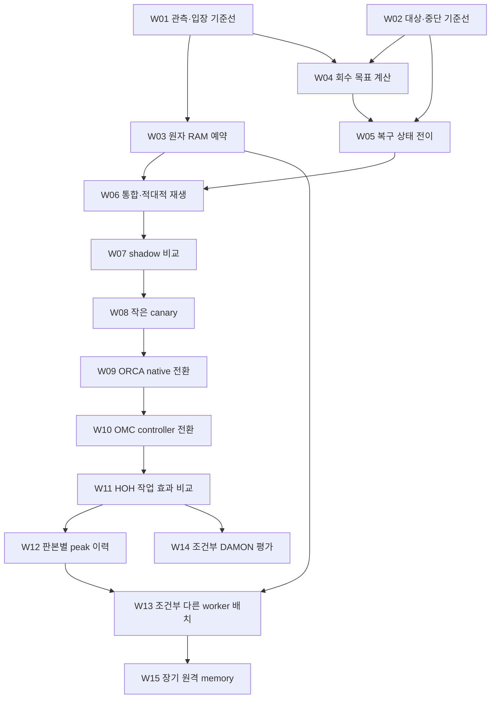

# 입운구 메모리 복구 계획 그래프

2026-11-08 · v2.0.0 · 작성·설계 귀속 SECONDARY_AI. [최초 요청](../records/2026-11-07/memory-plan/user-request.txt)과 [큰 작업 분해 요청](../records/2026-11-08/memory-plan-breakdown/user-request.txt)을 별도 출처로 보존한다.
독자는 사용자와 OMC/ORCA_SETTING/HOH 담당자다. 그래프를 읽는 실제 소비자는 `scripts/memory_plan.mjs`, 회귀 검사, OMC 전체 그래프 inventory다.

**6개 작업군 → 15개 담당 작업 → 45개 세부 단계 → 45개 산출물 계약으로 연결했다.** 각 단계는 담당·선행·입력·출력·검사·중단·재개 지점을 가진다. 구현·운영 작업은 아직 실행하지 않았다.

## 정본과 표준 사용

- [정본 JSON-LD](../graph/memory-recovery-plan.jsonld): 347개 노드, RDF 변환 후 5,379개 triple. JSON-LD 1.1의 inline context를 쓴다.
- [SHACL Core와 어휘 계약](../graph/memory-recovery-plan.shacl.ttl): 타입·domain/range·기수·필수 필드·권위 경계를 검사한다. dependency DAG와 파일 바이트/owner 발행 pin은 별도 소유 CLI가 검사한다.
- PROV-O의 `wasDerivedFrom`, `wasAttributedTo`, `hadPrimarySource`로 AI 설계·사용자 원문·공개 자료를 구분한다. 구조 PASS가 실행·효과 PASS를 뜻하지 않는다.
- `Dependency`, `StepDependency`, `EvidenceUse`는 역할·이유·관계 상태를 보존하는 명시적 노드다. 편의용 `dependsOn`/`afterStep`/`evidence` 투영과 정확히 일치해야 한다. 작업과 세부 단계의 의존성만 각각 비순환이어야 하며 전체 의미 그래프를 DAG로 강제하지 않는다. 실패 재개 `resumeAt`의 자기 참조·순환은 허용한다.
- `omc:knowledge:resource:memory`와 인역강의 기존 `research:work:omc-memory-admission-20261107:WHAT_IS/HOW_TO`를 재사용한다. 이름이 비슷한 새 개체로 갈아끼우지 않는다.
- 기존 rebalance knowledge 계약은 작업 순서·수용·rollback 타입을 지원하지 않으므로, 그 계약의 의미를 바꾸지 않고 이 작업 전용 계획 모델을 추가했다. 원문·논문·기존 구현의 소유는 그대로다.

이것은 owner-local RDF/SHACL 모델이다. 공유 KG에 발행하거나 HSWM 실행·지속 store를 열지 않았다. OMC에서 이미 사용하는 RDFJS 의존성만 재사용하며 HSWM runtime 모듈을 호출하지 않는다.

## 실제 확보한 자료

공개 자료 27개(논문 6, 핵심 코드 7, 문서 8, 라이선스 6)와 기존 연구 원문 2개, 이전 read-only 감사 1개, 사용자 원문 2개를 바이트에 결속했다. 총 32개 파일, 7,524,669 bytes다. 기존 논문 파일은 해시를 확인해 재사용했고, 원본은 `.local/rebalance-research/papers/`와 `.local/memory-plan/sources/`에 남는다. 대용량 원문을 Git에 복제하지 않는다.

논문은 TMO, Borg, Autopilot, DRF, Infiniswap, AIFM이다. 코드는 Senpai Python, oomd Senpai, damo, Kubernetes scheduler/kubelet eviction, Kueue scheduler, controller-runtime의 관련 파일이다. 이는 해당 저장소 전체 clone이나 빌드 완료를 뜻하지 않는다. 공개 commit, URL, 논문 연도/DOI, 읽은 절/함수, SHA-256과 바이트 수는 각각 SourceArtifact에 있다.

로컬 연구 원문은 허브 원장의 `COMPLETE`·역할·Git commit·source SHA까지 대조한다. 원문 출처 노드의 `PINNED_BYTES`, 연구 등록의 `COMPLETE`, 구현 작업의 `VERIFIED`는 서로 다른 상태다. `VERIFIED` 작업을 추가하려면 해당 work revision과 모든 수용 기준에 묶인 별도 실행 근거가 필요하다.

## 작업 순서



| 작업 | 담당 | 선행 | 산출물·완료를 판단할 핵심 |
| --- | --- | --- | --- |
| W01 관측·입장 기준선 | ORCA_SETTING | 없음 | 원천 시각, scope, capacity, cache credit, 예약을 구분한 계약. stale/future 입력 거절 |
| W02 대상·중단 기준선 | OMC | 없음 | target 신원·만료·기존 intent·예산 보존. 관측만으로 재개하지 않음 |
| W03 원자 RAM 예약 | ORCA_SETTING | W01 | 동시 시작의 과다 예약 차단, 같은 attempt의 멱등 반환, 실제 charge와 이중 차감 방지 |
| W04 회수 목표 계산 | OMC | W01·W02 | cache credit 감소까지 반영한 회복 목표. 작은 잔여 부족·상한·PSI·보호량 반례 통과 |
| W05 복구 상태 전이 | OMC | W02·W04 | 일시 대기/권한 만료/효과 없음/실행 불확실을 구분하고 누적 예산 유지 |
| W06 통합·적대적 재생 | OMC, ORCA 협업 | W03·W05 | 구/신 producer-consumer·동시성·대상 종료·rollback 경계 확인 |
| W07 shadow 비교 | OMC | W06 | 같은 현재 입력의 기존/후보 판단 비교. kernel·lease·정책 쓰기 0 |
| W08 작은 canary | OMC | W07 | 정확히 허용된 대상과 유한 예산에서 native 결과·지연 refault·PSI 확인 |
| W09 native 예약 판본 전환 | ORCA_SETTING | W08 | 기존 작업·lease를 보존하며 새 실행이 의도한 owner 판본을 읽는지 확인 |
| W10 controller 판본 전환 | OMC | W09 | 한 actuator writer, 권한 만료와 서비스 수명의 분리, 상태·예산 연속성 |
| W11 HOH 작업 효과 비교 | HOH | W10 | 동일 소스·도구·workload의 입장 지연, 완료율, peak, PSI, P95, OOM 비교 |
| W12 peak 이력 | OMC | W11 | 판본·domain별 수요와 OOM으로 잘린 표본을 보존하는 보수적 다음 예산 |
| W13 다른 worker 배치 | OMC, 조건부 | W03·W12 | owner 예약·호환성·데이터 이동 비용을 충족하는 배치안 |
| W14 DAMON 평가 | OMC, 조건부 | W11 | 커널 capability·제어권·관측 overhead를 확인한 채택/보류 결정 |
| W15 원격 memory | OMC, 조건부 | W13 | RDMA/네트워크 또는 앱 API 변경과 장애 복구를 포함한 실험 가능성 |

원격 memory의 검토는 DAMON을 필수 선행으로 요구하지 않는다. v1.0.1의 15개 작업 UID·의존성·출처 pin을 보존하며 아래에 세부 단계를 붙였다. 이전 판본은 Git `81a9313`이며 정본 `previousGraphCommit`에 전체 commit ID를 고정했다.

W01·W02와 W03·W04는 각각 서로 독립적인 선행 단위다. 이는 계획의 의존성 설명이며 agent를 자동 생성하거나 작업을 병렬 실행하는 명령이 아니다.

각 WorkItem은 입력·출력 계약, 담당 저장소, 실제 수정 대상의 기준 SHA, 근거 자료, 수용 기준과 반례, budget, rollback을 가진다. 운영 단계는 별도로 `AUTHORIZATION`, `IDENTITY`, `RESOURCE`, `EVIDENCE` gate를 요구하며 현재 모두 `UNVERIFIED`다. 조건부 단계의 kernel/worker/원격 memory 조건도 미확인으로 남긴다.

## 조회와 재현

OMC 루트에서 Node 24와 기존 RDFJS 도구 환경을 사용한다.

```sh
node scripts/memory_plan.mjs check
node scripts/memory_plan.mjs next
node scripts/memory_plan.mjs next-steps
node scripts/memory_plan.mjs sequence
node scripts/memory_plan.mjs roadmap
node scripts/memory_plan.mjs packet w03-s02
node scripts/memory_plan.mjs why w04
node scripts/memory_plan.mjs query rollout-prerequisites
node scripts/memory_plan.mjs query conditional
node scripts/memory_plan.mjs query papers
node scripts/memory_plan.mjs query implemented
node scripts/memory_plan.mjs sources
node --test tests/test_memory_plan.mjs
python3 -m unittest tests.test_graph_checks.SourceChecksTests
```

현재 `next`는 W01·W02, `next-steps`는 W01-S01·W02-S01을 반환한다. 이는 선행 의존성이 없는 계획 단위라는 뜻이며 runtime 실행 허가가 아니다. `packet`은 선택 단계의 부모·출처·수용 기준·rollback·합쳐진 gate·입출력 계약을 함께 반환한다. `implemented`의 답은 빈 배열이다. gate 검증·실행 효과·새 상태 기록을 이 CLI가 대신 수행하지 않는다.

검사는 13개 competency question의 정확한 답과 source role을 비교한다. 기존 8개 질문(다음 작업, 회수 근거, ORCA 소유 작업, 배포 전 선행, 조건부 작업, rollback, 논문, 검증된 구현)에 작업군, 다음 세부 단계, 예약 구현 분해, 실제 효과를 요구하는 단계, 생산자→소비자 인수인계를 추가했다.

읽기 전용 query는 선언된 graph 구조·국소 SELECT만 사용한다. 원문 바이트와 owner 발행 pin의 현재 일치는 `check`/`sources`에서 확인한다. 현재 구현 파일이 baseline SHA와 달라지면 `targetDrift`에 표시한다. 이전 관측이 새 코드의 증거가 되지 않도록 실제 착수 때 owner가 다시 기준선을 잡아야 한다.

```sh
# 명시적인 이 명령만 공개 HTTPS를 사용해 누락 bytes를 복원한다.
node scripts/memory_plan.mjs hydrate
# 재생성 가능한 교환 파일은 .local에 둔다.
node scripts/memory_plan.mjs export --format turtle --out .local/memory-plan/plan.ttl
node scripts/memory_plan.mjs export --format nquads --out .local/memory-plan/plan.nq
node scripts/memory_plan.mjs export --format mermaid --out .local/memory-plan/plan.mmd
node scripts/memory_plan.mjs export --format work-view --out .local/memory-plan/breakdown-20261108/work.json
node scripts/memory_plan.mjs export --format step-view --out .local/memory-plan/breakdown-20261108/steps.json
node scripts/memory_plan.mjs export --format turtle --out .local/memory-plan/breakdown-20261108/plan.ttl
river-graph validate --input .local/memory-plan/breakdown-20261108/steps.json
river-graph render --input .local/memory-plan/breakdown-20261108/steps.json --format svg --layout dot --output .local/memory-plan/breakdown-20261108/steps-proposed.svg
river-graph shacl --input .local/memory-plan/breakdown-20261108/plan.ttl --shapes graph/memory-recovery-plan.shacl.ttl
```

`hydrate`는 이미 있는 변경된 파일을 덮어쓰거나 remote pin을 갱신하지 않는다. URL의 내용이 달라졌으면 실패하며 새 판본 검토가 필요하다. 없는 원문은 `NOT_HYDRATED`다. 문서의 공개 URL은 변할 수 있으므로 그 경우 보존된 bytes 또는 검토한 후속 판본이 필요하다.

RDF 도구는 기존 `../HSWM/src/hswm/effect-runtime/package.json`에서 제3자 라이브러리만 해석한다. 다른 설치는 `OMC_RDF_RUNTIME`에 해당 package.json을 지정한다. 확인한 버전은 n3 2.7.2, jsonld 9.0.0, rdf-validate-shacl 0.6.5, Comunica query-sparql-rdfjs 5.3.0이다. 기존 설치를 변경하지 않았고 native HSWM 실행·store·권한 경로를 사용하지 않았다.

## 검증과 남은 단계

347개 노드/5,379개 triple의 실제 RDF 변환, SHACL Core, 32개 source bytes, owner 발행 pin, 13개 SPARQL 질의가 통과했다. 전용 65개와 기존 inventory/source 경계 6개 검사가 통과했다. 별도 `river-graph`의 pySHACL도 동일 RDF/SHACL을 통과했다. 공용 도구의 구조 PASS는 owner 의미 검증의 대체물이 아니다.

중복 ID, 끊긴 끝점, 잘못된 owner, 의존성 cycle, 누락 rollback/반례, 부모 선행 우회, 허구의 추가 선행, 미전달 산출물, 미래 출력 소비, read-only 아래 actuation 숨기기, 조건부 단계의 ready 승격, 미완료 자식을 둔 부모 완료, 권위 승격, byte 손상·누락·경로 탈출, 틀린 질의 답을 거절했다. 완료 evidence는 단계/부모 revision·검사 목록·출력 digest와 결속해야 한다.

이번 readback에서 `scripts/ops.py`와 `docs/AI_OPERATIONS.md`가 v1 기준 SHA에서 달라졌다. 원래 pin을 자동 갱신하지 않았으며, 실제 착수 때 현재 owner 변경분을 다시 확인해야 한다. 이 drift는 계획 검사의 실패나 runtime 검증 성공을 뜻하지 않는다.

이 결과는 계획 구조와 출처 연결의 검증이다. 메모리 복구·예약 구현, 운영 성능 개선, kernel reclaim, controller 재시작, 원격 작업 배정은 이번 구축에서 실행하지 않았다. 다음 소비자는 `next`와 `why`로 W01·W02의 입력을 확인한 뒤 각 owner의 작업 범위에서 착수한다.

## 큰 작업의 인수인계 계약

| 작업군 | 범위 | 완료 관문 |
| --- | --- | --- |
| S01 관측과 대상 기준선 | W01–W02, 6단계 | 원천 freshness·domain·target expiry를 구분한 기준선 |
| S02 예약·회수·복구 핵심 | W03–W05, 9단계 | 원자 예약, 회수 오차, crash 후 예산 보존 검증 |
| S03 통합 검증과 제한 적용 | W06–W08, 9단계 | 교차 판본 replay → 무쓰기 shadow → 허용된 canary |
| S04 소유자별 전환과 HOH 효과 | W09–W11, 9단계 | ORCA → OMC 실제 판본 readback과 동일 HOH workload 비교 |
| S05 판본별 수요 예산 | W12, 3단계 | OOM 검열 표본·시간 분리 평가·희소 표본 fallback |
| S06 조건부 확장 연구 | W13–W15, 9단계 | 선택 분기별 worker·kernel·network 조건과 채택/보류 이유 |

작업군은 읽기 위한 묶음이며 새 순서 제약이 아니다. 각 부모의 첫 단계는 기존 `dependsOn`의 마지막 단계 출력을 받으며 내부 단계는 자기 부모 안에서 이어진다. 세부 단계의 쓰기 소유자와 대상 경로는 부모 범위를 넘지 못한다. `OutputContract`는 앞으로 만들 산출물의 필드·검사 규칙이며, 이미 확보한 `SourceArtifact`와 구분한다.

조건부 연구 3개는 선행 완료만으로 ready에 포함되지 않는다. W08/W09/W10/W14/W15의 S02는 실제 owner 효과가 있는 단계이며 권한·신원·자원·검증 gate를 상속한다. 나머지 단계의 로컬 문서·코드·시험 출력은 운영 actuator 효과로 분류하지 않는다. 출력은 모두 EXPECTED, 완료 관문은 모두 NOT_EVALUATED다.

실행자는 `packet <단계>`를 읽고 fresh 관측·현재 owner 정책으로 시간/표본/RAM 예산을 구체화한다. 단계마다 정해진 입력 계약·산출물·검증 묶음까지만 진행하며, 실패 기록을 남긴 뒤 해당 `resumeAt`에서 입력을 다시 확인한다. 의존성상 함께 가능한 작업을 자동 agent 생성이나 고정 동시 슬롯 수로 바꾸지 않는다.

시각화는 [.local의 전체 작업 SVG](../.local/memory-plan/breakdown-20261108/work-proposed.svg)와 [45단계 SVG](../.local/memory-plan/breakdown-20261108/steps-proposed.svg)로 생성했다. SVG 화살표는 정본과 같이 **후행 → 선행**을 가리킨다. 위 Mermaid는 진행 순서를 읽기 쉽게 반대로 그린 표시다. JSON view는 원래 노드·관계 UID·이유를 보존한 표시용 투영이며 정본이나 실행 입력이 아니다. 생성 그림은 Git에 보관하지 않는다.

## 45개 세부 단계

| 단계 | 작업 | 예상 산출물 | 완료 조건 |
| --- | --- | --- | --- |
| W01-S01 | 원천 관측과 입장 경로 목록화 | 관측 경로 목록 | 각 판단 값의 원천·단위·시각·domain이 연결된다. |
| W01-S02 | 판본 있는 freshness·headroom 계약 | 입장 관측 계약 | raw 여유·credit·예약·유효 여유를 중복 계산 없이 구분한다. |
| W01-S03 | 시간·scope 경계 fixture 고정 | 관측 회귀 결과 | stale/future/다른 domain/누락 값이 명시적 거절로 귀결된다. |
| W02-S01 | 대상 신원·만료·intent 목록화 | 대상 신원 목록 | 실행 중·만료·사라진 대상을 읽기만 하여 구분한다. |
| W02-S02 | 중단 사유와 누적 예산 계약 | 복구 가능성 기준선 | 일시 대기·권한 만료·효과 없음·실행 불확실을 별도 사유로 둔다. |
| W02-S03 | 무쓰기 신원·만료 반례 재생 | 대상 검증 결과 | 만료·교체·불확실 사례를 차단하고 외부 상태 쓰기가 0이다. |
| W03-S01 | RAM 예약 lease와 이행 계약 | 예약 lease 계약 | 신규·기존 lease 호환과 예약/실제 charge 전환을 정의한다. |
| W03-S02 | 원자 reserve·release 구현 | 예약 구현 판본 | 같은 domain의 검사와 예약이 하나의 원자 경계에 들어간다. |
| W03-S03 | 경쟁·재시작·멱등 반환 검증 | 예약 검증 묶음 | 예약 총량 상한·중복 release·만료·재시작 보존이 모두 통과한다. |
| W04-S01 | credit를 반영한 회수 수학 고정 | 회수 목표 모델 | credit 구간과 high 경계를 포함한 회수 후 여유를 계산한다. |
| W04-S02 | 유한 회복 목표 planner 구현 | 회수 planner 판본 | 미소 부족분을 보존하면서 보호량·요청/회차/총량 상한을 지킨다. |
| W04-S03 | 부분 회수·EAGAIN·refault 경계 검증 | 회수 계산 검증 묶음 | 요청량과 관측 회수량을 구분하고 악화·무진전·불확실에 정지한다. |
| W05-S01 | 복구 episode 전이표 확정 | 복구 상태 전이 계약 | 복구 가능 대기와 terminal·uncertain 상태를 구분한다. |
| W05-S02 | episode·예산 지속 저장 구현 | 복구 상태 구현 판본 | 상태·시도 ID·누적 비용을 내구성 경계로 보존한다. |
| W05-S03 | crash·만료·중복 coordinator 검증 | 복구 연속성 결과 | 불확실 실행을 자동 retry하지 않고 single writer와 예산 단조성을 지킨다. |
| W06-S01 | producer-consumer 호환 행렬 고정 | 교차 판본 시험 행렬 | 구/신 native와 controller 조합별 허용·거절을 명시한다. |
| W06-S02 | 적대적 통합 trace 재생 | 통합 trace 결과 | 동시 예약·target 종료·stale·부분 회수·rollback trace를 통과한다. |
| W06-S03 | 판본별 호환 근거 묶음 확정 | 통합 인수인계 묶음 | 실제 통과와 미측정을 분리한 고정 digest 묶음을 만든다. |
| W07-S01 | shadow 입력·판정 기준 사전 등록 | shadow 비교 계획 | 같은 관측에서 기존/후보 판단을 비교할 수 있다. |
| W07-S02 | 유한 shadow 표본 관측 | shadow 관측 표본 | kernel·lease·정책 쓰기 없이 등록된 표본 범위만 수집한다. |
| W07-S03 | 판단 차이와 canary 가능성 평가 | shadow 채택 판단 | 차이의 원인과 미측정을 설명하고 후보/보류를 결정한다. |
| W08-S01 | canary 범위·예산·복구점 확인 | canary 실행 명세 | fresh identity·유효 위임·자원·복구 근거가 모두 같은 대상에 묶인다. |
| W08-S02 | 허용된 작은 canary 실행 | canary 원시 실행 기록 | 허용된 단일 범위와 누적 상한 안에서 실제 결과를 남긴다. |
| W08-S03 | 지연 refault·PSI·상태 readback | canary 효과 판단 | 즉시 여유와 지연 비용을 함께 보고 채택/되돌림을 결정한다. |
| W09-S01 | native 릴리스와 lease 보존 준비 | ORCA 전환 명세 | 동작 중 lease를 보존할 호환·백업·되돌림 절차가 고정된다. |
| W09-S02 | ORCA owner 절차로 native 전환 | ORCA 전환 기록 | owner 절차로 정확한 artifact를 반영하고 기존 세션을 보존한다. |
| W09-S03 | 새 실행 판본·lease readback | ORCA 전환 검증 | 새 작업의 실제 판본과 기존 예약 연속성이 확인된다. |
| W10-S01 | controller 단일 writer·checkpoint 준비 | OMC 전환 명세 | writer 중복 방지와 episode·예산 보존 경계가 확인된다. |
| W10-S02 | OMC owner 절차로 controller 전환 | OMC 전환 기록 | 정확한 controller 판본 하나가 기존 상태를 이어받는다. |
| W10-S03 | 판본·만료·예산 연속성 readback | OMC 전환 검증 | single writer·만료 준수·예산 단조성을 실제 상태로 확인한다. |
| W11-S01 | HOH 동일 workload 비교 설계 | HOH 비교 명세 | 같은 소스·기기 조건·작업 정의의 전후 비교가 가능하다. |
| W11-S02 | HOH browser·build 제한 비교 | HOH 측정 결과 | 작업별 입장 지연·완료·peak·PSI·P95·OOM을 유한 실행으로 기록한다. |
| W11-S03 | 메모리 효과·회귀 판정 | HOH 효과 보고 | 표본 크기·미측정·변동을 보존해 유지/되돌림을 결정한다. |
| W12-S01 | peak·검열 표본 계약 | 수요 표본 계약 | OOM·취소·입장 거절을 서로 다른 표본 상태로 보존한다. |
| W12-S02 | 판본별 보수적 수요 추정 | 예산 추정 구현 | 판본/domain을 분리하고 희소 표본에는 현재 owner fallback을 쓴다. |
| W12-S03 | 시간 분리·검열·이상 표본 평가 | 예산 추정 검증 | 미래 누출 없이 부족 추정과 과다 예약 tradeoff를 평가한다. |
| W13-S01 | 등록 worker·데이터 이동 조건 확인 | 배치 가능 조건 목록 | 등록 owner·호환성·데이터 이동권을 확인한다. |
| W13-S02 | 다자원·전송비용 배치안 작성 | 배치 후보 계약 | DRF 관점의 병목과 이동 비용을 명시한 후보를 만든다. |
| W13-S03 | 배치 shadow로 채택·보류 판단 | 배치 분기 판단 | 원격 실행 없이 후보 타당성과 남은 owner 조건을 결정한다. |
| W14-S01 | DAMON 커널·제어권 조건 확인 | DAMON 조건 목록 | 지원 기능과 기존 controller 충돌 여부를 읽어서 확인한다. |
| W14-S02 | 허용된 격리 DAMON 관측 평가 | DAMON 비용 관측 | 정확한 격리 범위에서 비용과 cleanup을 유한 측정한다. |
| W14-S03 | DAMON 채택·보류와 철거 판정 | DAMON 분기 판단 | 이득·비용·미지원 조건을 설명하고 보류 또는 다음 실험을 제안한다. |
| W15-S01 | 원격 memory 실패·API 가정 정의 | 원격 memory 가정 계약 | RDMA 방식과 앱 API 방식의 적용 조건을 구분한다. |
| W15-S02 | 허용된 격리 prototype 계측 | 원격 memory 실험 결과 | 유한한 격리 prototype에서 장애·비용·정리 결과를 기록한다. |
| W15-S03 | 장애 복구·성능·도입비 판정 | 원격 memory 분기 판단 | 성능과 통합/운영 비용을 근거로 후속 구현 또는 보류를 결정한다. |
