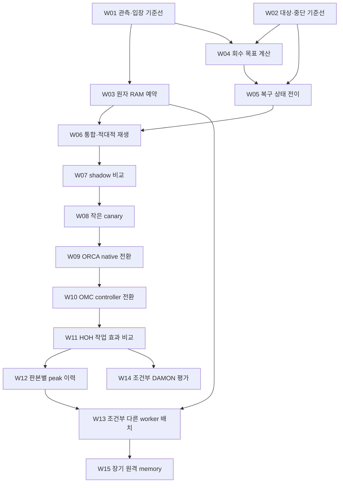

# 입운구 메모리 복구 계획 그래프

2026-11-07 · 작성·설계 귀속 SECONDARY_AI. 사용자 요청 원문은 [별도 출처](../records/2026-11-07/memory-plan/user-request.txt)에 보존한다.
독자는 사용자와 OMC/ORCA_SETTING/HOH 담당자다. 그래프를 읽는 실제 소비자는 `scripts/memory_plan.mjs`, 회귀 검사, OMC 전체 그래프 inventory다.

**구축 범위는 자료 확보와 검증 가능한 작업 계획이다. 15개 구현·운영 작업을 실행 완료로 표시하지 않는다.**

## 정본과 표준 사용

- [정본 JSON-LD](../graph/memory-recovery-plan.jsonld): 192개 노드, RDF 변환 후 2,435개 triple. JSON-LD 1.1의 inline context를 쓴다.
- [SHACL Core와 어휘 계약](../graph/memory-recovery-plan.shacl.ttl): 타입·domain/range·기수·필수 필드·권위 경계를 검사한다. dependency DAG와 파일 바이트/owner 발행 pin은 별도 소유 CLI가 검사한다.
- PROV-O의 `wasDerivedFrom`, `wasAttributedTo`, `hadPrimarySource`로 AI 설계·사용자 원문·공개 자료를 구분한다. 구조 PASS가 실행·효과 PASS를 뜻하지 않는다.
- `Dependency`와 `EvidenceUse`는 역할·이유·관계 상태를 보존하는 명시적 노드다. 편의용 `dependsOn`/`evidence` 투영과 정확히 일치해야 한다. `dependsOn`만 비순환이어야 하며 전체 의미 그래프를 DAG로 강제하지 않는다.
- `omc:knowledge:resource:memory`와 인역강의 기존 `research:work:omc-memory-admission-20261107:WHAT_IS/HOW_TO`를 재사용한다. 이름이 비슷한 새 개체로 갈아끼우지 않는다.
- 기존 rebalance knowledge 계약은 작업 순서·수용·rollback 타입을 지원하지 않으므로, 그 계약의 의미를 바꾸지 않고 이 작업 전용 계획 모델을 추가했다. 원문·논문·기존 구현의 소유는 그대로다.

이것은 owner-local RDF/SHACL 모델이다. 공유 KG에 발행하거나 HSWM 실행·지속 store를 열지 않았다. OMC에서 이미 사용하는 RDFJS 의존성만 재사용하며 HSWM runtime 모듈을 호출하지 않는다.

## 실제 확보한 자료

공개 자료 27개(논문 6, 핵심 코드 7, 문서 8, 라이선스 6)와 기존 연구 원문 2개, 이전 read-only 감사 1개, 이번 사용자 원문 1개를 바이트에 결속했다. 총 31개 파일, 7,524,579 bytes다. 기존 논문 파일은 해시를 확인해 재사용했고, 원본은 `.local/rebalance-research/papers/`와 `.local/memory-plan/sources/`에 남는다. 대용량 원문을 Git에 복제하지 않는다.

논문은 TMO, Borg, Autopilot, DRF, Infiniswap, AIFM이다. 코드는 Senpai Python, oomd Senpai, damo, Kubernetes scheduler/kubelet eviction, Kueue scheduler, controller-runtime의 관련 파일이다. 이는 해당 저장소 전체 clone이나 빌드 완료를 뜻하지 않는다. 공개 commit, URL, 논문 연도/DOI, 읽은 절/함수, SHA-256과 바이트 수는 각각 SourceArtifact에 있다.

로컬 연구 원문은 허브 원장의 `COMPLETE`·역할·Git commit·source SHA까지 대조한다. 원문 출처 노드의 `PINNED_BYTES`, 연구 등록의 `COMPLETE`, 구현 작업의 `VERIFIED`는 서로 다른 상태다. `VERIFIED` 작업을 추가하려면 해당 work revision과 모든 수용 기준에 묶인 별도 실행 근거가 필요하다.

## 작업 순서



| 작업 | 담당 | 선행 | 산출물·완료를 판단할 핵심 |
| --- | --- | --- | --- |
| W01 관측·입장 기준선 | ORCA_SETTING | 없음 | 원천 시각, scope, capacity, cache credit, 예약을 구분한 계약. stale/future 입력 거절 |
| W02 대상·중단 기준선 | OMC | 없음 | target 신원·만료·기존 intent·예산 보존. 관측만으로 재개하지 않음 |
| W03 원자 RAM 예약 | ORCA_SETTING | W01 | 동시 시작의 과다 예약 차단, 같은 attempt의 멱등 반환, 실제 charge와 이중 차감 방지 |
| W04 회수 목표 계산 | OMC | W01·W02 | cache credit 감소까지 반영한 회복 목표. 작은 잔여 부족·상한·PSI·보호량 반례 통과 |
| W05 복구 상태 전이 | OMC | W02·W04 | 일시 대기/권한 만료/효과 없음/실행 불확실을 구분하고 누적 예산 유지 |
| W06 통합·적대적 재생 | OMC, ORCA 협업 | W03·W05 | 구/신 producer-consumer·동시성·대상 종료·rollback 경계 확인 |
| W07 shadow 비교 | OMC | W06 | 같은 현재 입력의 기존/후보 판단 비교. kernel·lease·정책 쓰기 0 |
| W08 작은 canary | OMC | W07 | 정확히 허용된 대상과 유한 예산에서 native 결과·지연 refault·PSI 확인 |
| W09 native 예약 판본 전환 | ORCA_SETTING | W08 | 기존 작업·lease를 보존하며 새 실행이 의도한 owner 판본을 읽는지 확인 |
| W10 controller 판본 전환 | OMC | W09 | 한 actuator writer, 권한 만료와 서비스 수명의 분리, 상태·예산 연속성 |
| W11 HOH 작업 효과 비교 | HOH | W10 | 동일 소스·도구·workload의 입장 지연, 완료율, peak, PSI, P95, OOM 비교 |
| W12 peak 이력 | OMC | W11 | 판본·domain별 수요와 OOM으로 잘린 표본을 보존하는 보수적 다음 예산 |
| W13 다른 worker 배치 | OMC, 조건부 | W03·W12 | owner 예약·호환성·데이터 이동 비용을 충족하는 배치안 |
| W14 DAMON 평가 | OMC, 조건부 | W11 | 커널 capability·제어권·관측 overhead를 확인한 채택/보류 결정 |
| W15 원격 memory | OMC, 조건부 | W13 | RDMA/네트워크 또는 앱 API 변경과 장애 복구를 포함한 실험 가능성 |

원격 memory의 검토는 DAMON을 필수 선행으로 요구하지 않는다. 두 기술의 적용 조건이 달라 W14→W15 의존성을 제거한 계획 v1.0.1을 정본으로 삼았다.

W01·W02와 W03·W04는 각각 서로 독립적인 선행 단위다. 이는 계획의 의존성 설명이며 agent를 자동 생성하거나 작업을 병렬 실행하는 명령이 아니다.

각 WorkItem은 입력·출력 계약, 담당 저장소, 실제 수정 대상의 기준 SHA, 근거 자료, 수용 기준과 반례, budget, rollback을 가진다. 운영 단계는 별도로 `AUTHORIZATION`, `IDENTITY`, `RESOURCE`, `EVIDENCE` gate를 요구하며 현재 모두 `UNVERIFIED`다. 조건부 단계의 kernel/worker/원격 memory 조건도 미확인으로 남긴다.

## 조회와 재현

OMC 루트에서 Node 24와 기존 RDFJS 도구 환경을 사용한다.

```sh
node scripts/memory_plan.mjs check
node scripts/memory_plan.mjs next
node scripts/memory_plan.mjs sequence
node scripts/memory_plan.mjs why w04
node scripts/memory_plan.mjs query rollout-prerequisites
node scripts/memory_plan.mjs query conditional
node scripts/memory_plan.mjs query papers
node scripts/memory_plan.mjs query implemented
node scripts/memory_plan.mjs sources
node --test tests/test_memory_plan.mjs
python3 -m unittest tests.test_graph_checks.SourceChecksTests
```

현재 `next`는 W01·W02를 반환한다. 이는 선행 의존성이 없는 계획 단위라는 뜻이며 runtime 실행 허가가 아니다. `implemented`의 답은 빈 배열이다. gate 검증·실행 효과·새 상태 기록을 이 CLI가 대신 수행하지 않는다.

검사는 8개 competency question의 정확한 답과 source role을 비교한다. 질문은 다음 작업, 회수 근거, ORCA 소유 작업, 배포 전 모든 선행 작업, 조건부 작업, rollback, 확보 논문, 이미 검증된 구현이다.

읽기 전용 query는 선언된 graph 구조·국소 SELECT만 사용한다. 원문 바이트와 owner 발행 pin의 현재 일치는 `check`/`sources`에서 확인한다. 현재 구현 파일이 baseline SHA와 달라지면 `targetDrift`에 표시한다. 이전 관측이 새 코드의 증거가 되지 않도록 실제 착수 때 owner가 다시 기준선을 잡아야 한다.

```sh
# 명시적인 이 명령만 공개 HTTPS를 사용해 누락 bytes를 복원한다.
node scripts/memory_plan.mjs hydrate
# 재생성 가능한 교환 파일은 .local에 둔다.
node scripts/memory_plan.mjs export --format turtle --out .local/memory-plan/plan.ttl
node scripts/memory_plan.mjs export --format nquads --out .local/memory-plan/plan.nq
node scripts/memory_plan.mjs export --format mermaid --out .local/memory-plan/plan.mmd
```

`hydrate`는 이미 있는 변경된 파일을 덮어쓰거나 remote pin을 갱신하지 않는다. URL의 내용이 달라졌으면 실패하며 새 판본 검토가 필요하다. 없는 원문은 `NOT_HYDRATED`다. 문서의 공개 URL은 변할 수 있으므로 그 경우 보존된 bytes 또는 검토한 후속 판본이 필요하다.

RDF 도구는 기존 `../HSWM/src/hswm/effect-runtime/package.json`에서 제3자 라이브러리만 해석한다. 다른 설치는 `OMC_RDF_RUNTIME`에 해당 package.json을 지정한다. 확인한 버전은 n3 2.7.2, jsonld 9.0.0, rdf-validate-shacl 0.6.5, Comunica query-sparql-rdfjs 5.3.0이다. 기존 설치를 변경하지 않았고 native HSWM 실행·store·권한 경로를 사용하지 않았다.

## 검증과 남은 단계

192개 노드/2,435개 triple의 실제 RDF 변환, SHACL Core, 31개 source bytes, owner 발행 pin, 8개 SPARQL 질의가 통과했다. graph 도구 36개와 기존 inventory/source 경계 6개 검사가 통과했다. 중복 ID, 끊긴 끝점, 잘못된 owner, cycle, 누락 rollback/반례, 연구 완료를 실행 완료로 바꾸기, 권위 승격, byte 손상, 누락 hydration, symlink/path 탈출, 원격 context/SERVICE, 모양만 맞고 답이 틀린 질의를 거절했다.

이 결과는 계획 구조와 출처 연결의 검증이다. 메모리 복구·예약 구현, 운영 성능 개선, kernel reclaim, controller 재시작, 원격 작업 배정은 이번 구축에서 실행하지 않았다. 다음 소비자는 `next`와 `why`로 W01·W02의 입력을 확인한 뒤 각 owner의 작업 범위에서 착수한다.
