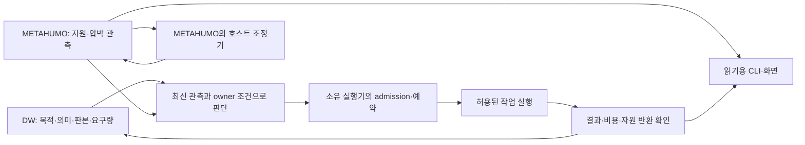

# OMC 기술 운영 기준 — DW와 METAHUMO를 연결하는 방법

2026-10-26 · `SECONDARY_AI` · [운영 헌법](OMC_CONSTITUTION.md)의 적용 설계.
회사 원천 7개를 고정 판본으로 가져와 검토했다. [원문·판본·해시·적용 판단](../records/2026-10-26/omc-authority-operating-model/README.md)을 따른다.
이 문서 작성으로 새 daemon·실행 권한·자동 배정·MHC 정산을 배포한 것은 아니다.

## 1. 권한과 구현 위치

사용자가 정한 경계는 **우리 = Dimension Walker 권한 / 회사 = METAHUMO 권한**이다.
아래 책임 배분은 그 경계와 기존 구현을 연결하는 운영 설계다. 권한 이름 자체가 root·SSH·KG writer 권한을 발급하지 않는다.

| 판단·효과 | DW 쪽 책임과 현재 위치 | 회사 METAHUMO 쪽 책임과 현재 위치 |
|---|---|---|
| 목적·의미·원천 판본 | OMC 설계, HSWM 문맥·출처, 인역강 연구 연결 | 회사 작업의 원천과 도메인 소유 계약 유지 |
| 장비 신원·현재 상태 | 기존 UID와 원천 namespace를 보존해 조회·해석 | AILAB `graph/hosts.json`, `graph/compute.json`, `compute/resources.py` |
| 호스트 압박과 배치 조절 | 회사 owner에 필요한 요구·예산을 전달 | AILAB `graph/rebalance.json`, `compute/rebalance.py`, `ailab-batch` |
| 허용 작업의 예약·실행·복구 | 기존 broker·OMC adapter와 서명 요청 계약 사용 | 선택한 실행 owner가 admission·예산·작업 식별자·결과를 확인 |
| 회사 관측 화면 | 필요하면 현재 API의 출처·시각을 보존해 소비 | METAHUMO_MANUFACTURE의 입체운행구름 앱, AILAB 관측·이력 API |
| 개인의 관측 화면·기여 접점 | HOH의 기존 소유 범위와 연결 | 회사 앱을 개인 앱으로 개명하거나 소유권을 이전하지 않음 |
| 기여 검증·정산 | MHC의 검증·이의·정산 계약에 연결 | 허용된 기여의 원천 실행 근거 제공; 사용률 자체를 보상으로 발행하지 않음 |

회사 AILAB·MM·각 도메인 저장소는 계속 원천 소유자다. 가져오는 것은 검증한 원칙·명세와 필요한 연결이며,
회사 구현의 독립적인 사본을 또 운영하거나 같은 cgroup에 두 번째 조정기를 붙이지 않는다.
DW 원천 보관·회사 native 실행 정책은 [우리의 위임 payload 경계](NATIVE_RESOURCE_MIGRATION.md)에 적용된다.
회사가 자체 소스 저장소·개발 도구를 보유하는 것을 금지하는 일반 법칙으로 확장하지 않는다.

## 2. 유지할 운영 연결



이것은 책임·정보 흐름이다. DW가 원격 메모리 설정을 직접 쓰거나 HSWM 정본 W를 자동 변경한다는 뜻이 아니다.
호스트 조절은 짧은 주기, 작업 배정은 제출·완료 사건, HSWM 정책 개선은 검증된 결과에 맞춰 별도로 수행한다.
제어 주기·TTL·예산은 해당 owner 정책에서 읽는다. 회사의 25 GiB 여유 목표·5초 주기·DTD 프로필을 dev-01의 기본값으로 복제하지 않는다.

## 3. 회사에서 가져와 적용할 원칙

| 원칙 | OMC에서의 적용 | 완료를 판단할 근거 |
|---|---|---|
| 보호·대화·배치 구분 | 호스트마다 보호 대상과 제어 가능한 cgroup/작업 범위를 명시 | 실제 귀속·설정과 동작, 보호 서비스 불변 확인 |
| 한 제어 대상의 책임 owner | Dell의 기존 `ailab-rebalance`를 존중; 과거 `omc-job-memory-cap`과 중복 제어하지 않음 | 현재 활성 writer와 제어 범위가 하나의 정책 경로로 설명됨 |
| 관측·예약·권한 분리 | CPU 사용률은 예약 코어가 아니며 GPU별 VRAM·UMA를 구분 | stale·누락·지원하지 않는 자원 요구를 거절하는 실제 경로 |
| 설명 가능한 배정 | 선택/탈락 이유·정책 판본·원천 관측·입력 판본을 기존 job/attempt에 연결 | 같은 입력·판본으로 이유를 되읽고 실제 대상과 대조 |
| 실행 뒤 검증·반납 | 제출 응답과 완료를 구분, 불확실한 시도는 같은 ID로 재조회 | 결과 내용·종료 상태·예약 반환을 확인; 재조회가 중복 실행을 만들지 않음 |
| 지속 관측과 사람의 화면 | 현재값·이력·오래됨·실패를 같은 근거에서 표시 | API와 화면의 같은 노드·시각·단위; 단절 때 UNKNOWN 표시 |
| 판본에 묶인 CI | 검사 명령·자원 예산·검사한 commit·결과를 결속 | 실행 결과와 게시 결과를 따로 확인; 미등록은 미구성 |

회사 `ailab/local-ci`의 조직 기본값은 회사 소유 결정이다. 개인 CI의 실행 위치·공개 범위는 개인 소유 계약에서 정한다.
회사 그래프를 읽었다는 이유로 회사 GitHub 쓰기나 모든 회사 작업의 배정 권한을 추가하지 않는다.

## 4. 서로 다른 메모리 작업을 구분한다

| 작업 | 의미와 경계 |
|---|---|
| `memory.high`·CPU weight 조절 | 호스트/계정의 배치를 느리게 하거나 우선순위를 조정. 예약량·VRAM 한도·OOM 방지 보장이 아님 |
| 캐시 회수 | 허용된 정확한 cgroup의 회수 가능 캐시. DW의 기존 `ops memory reclaim`은 boot ID·inode·보호량 검사를 유지 |
| 프로세스의 배치 귀속 변경 | 회사 delltower 프로필의 제한된 입양 기능. DTD `batch_only`에는 같은 권한을 가정하지 않음 |
| zram·OS 메모리 압축 | 해당 호스트의 별도 OS 정책과 권한. 회사의 설치 전례를 dev-01 또는 다른 노드의 설치 허가로 사용하지 않음 |
| 노드 간 작업 배정 | 지원 템플릿·입력·예약·결과 계약을 가진 작업을 배정. 실행 중 프로세스의 투명 이동과 구분 |
| 데이터·모델 이전 | 의미·판본·출처, 전송 비용과 이동 중 최대 메모리, rollback을 검증하는 별도 owner 작업 |

회사 문서는 systemd의 선언 `MemoryHigh`와 cgroup의 현재 `memory.high`가 다를 수 있음을 설명한다.
살아 있는 배치보다 낮은 선언을 reload로 반복 적용해 관리자 응답을 막았던 사례도 기록한다.
따라서 설정 파일만으로 동작을 판정하지 않고 실제 제어값·마지막 성공 판단·로그를 함께 읽는다.
이 전례를 OMC가 회사 유닛을 직접 수정하는 실행 지침으로 사용하지 않는다.

## 5. 지금 사용할 읽기 경로

아래는 이미 설치된 경로의 조회다. 회사 명령은 회사 소유자의 기존 접속 범위에서만 사용한다.
설정·인증 파일의 비밀을 출력하지 않는다. 모델 생성·작업 제출·재시작은 아래 명령에 포함되지 않는다.

```sh
# DW / 이 저장소
python3 cli.py ops catalog
python3 cli.py ops inspect --config .local/ops/config.json
python3 cli.py agents inspect
omc-dgx status --json
systemctl --user show omc-ops-controller.service omc-ops-prometheus.service --property=Id,ActiveState,Result,RuntimeMaxUSec

# 회사 METAHUMO의 기존 계정·CLI
ssh delltower '~/.local/bin/ailab-rebalance status --json'
ssh delltower '~/.local/bin/ailab-compute pc --json list'
ssh delltower '~/.local/bin/ailab-compute job --json templates'
```

`pc list`는 저장 관측을 읽으므로 `observed_at`·`age_seconds`·`stale`·`error`를 반드시 함께 본다.
`--refresh`는 원격 조회와 소유 상태·이력 갱신을 수행한다. `job templates`는 실행 가능한 계약 목록이며 실행 요청이 아니다.
조회 접근과 서명된 worker 실행은 서로 다른 경로다. 회사 owner 명령을 `omc-worker`의 제한된 forced command 대신 임의 실행하는 우회로로 쓰지 않는다.

## 6. 상태를 판독하는 방법

`systemd failed` 하나만으로 수집기나 실행기가 고장 났다고 판정하지 않는다.

| 관측 | 확인할 구분과 다음 판단 |
|---|---|
| 우리 ops의 `Result=timeout` | 이번 조회에서는 선언된 24시간 수명 종료. 재기동 전에 보관 위치·admission·현 소유 정책 확인 |
| fleet collector의 exit 3 | 기존 코드에서는 critical 경보를 뜻함. 보고서 시각·성공 노드·접속 실패를 읽어 관측 중단과 구분 |
| 회사 로컬 CI의 exit 1 | 이번 로그는 특정 commit의 기존 검사 실패 재보고. 검사가 실패한 것과 실행기 기동 장애를 구분 |
| `active`지만 오래된 `daemonAt` | 성공적인 제어 반복을 증명하지 못함. 새 배정에 오래된 관측을 쓰지 않음 |
| GPU/CPU 사용률이 낮음 | 작업 가능 권한·데이터·여유 예약·장치 독점 조건을 따로 확인 |
| 작업 timeout 뒤 결과 미확인 | 예약과 시도 ID를 보존해 되읽기. 동일 작업을 새 ID로 즉시 재실행하지 않음 |

2026-10-26 비교에서는 회사 수집기·리밸런서가 가동 중이고 현재값·이력 API가 10개 노드를 반환했다.
회사 작업 목록은 성공 13·취소 3·실패 1이었으며 자동 배정은 `dispatch_enabled=false`, 고정 템플릿은 2종이었다.
우리 ops의 6개 endpoint와 두 A2A agent는 응답하지 않았고, 별도 DGX 상세 관측과 두 모델 endpoint는 정상이었다.
fleet 수집은 7개 중 6개 성공·1개 연결 실패였다. 이 수치는 당시 관측이며 지금의 상태나 성능 비교 점수가 아니다.
회사 문서 일부의 과거 DTD `max_jobs: 0` 설명과 확인한 현재 정책 `max_jobs: 1`도 구분한다. 현재 배정 가능 여부는 현 정책·CLI·admission으로 확인한다.

## 7. 다음 구축 순서와 수용 기준

아래는 아직 완료하지 않은 운영 통합 계획이다. 같은 역할의 새 registry·queue·controller를 먼저 만들지 않는다.

| 순서 | 맡을 곳과 연결 | 완료 기준 |
|---|---|---|
| 1. DW 관측의 지속성 | OMC ops/agents 소유 코드와 개인 저장·실행 owner. 현재 임시 DB·1시간/24시간 수명을 검토 | 실제 admission된 보관 위치, 예산·보존·중단·복구 정책, 서비스/관측 신선도 확인. 임시 제한 삭제만으로 완료하지 않음 |
| 2. METAHUMO 관측 재사용 | 기존 AILAB 조회와 DW의 기존 fleet/관측 adapter | 원천 namespace+host UID·관측 시각·정책 판본을 보존. 미연결·중복 호스트·UMA·stale 반례 통과 |
| 3. 유용한 실제 작업 하나 연결 | 기존 DW broker와 METAHUMO 실행 owner. 업무 목적과 검증 가능한 결과를 먼저 선정 | 목적→요청→원자 예약→실행→정확한 결과→반납을 한 job/attempt에서 확인; 실패·취소·재조회도 검증 |
| 4. 다음 실행에 피드백 반영 | 기존 OMC `rebalance`/feedback 경로와 HSWM 소유 계약 | 채택한 예산·경로 판본을 다음 실행이 읽는지 확인. 개선 효과는 동일 조건의 기준선과 별도 비교 |
| 5. 사용자에게 지속 제공 | 개인은 HOH, 회사는 MM의 기존 화면·API | 현재값과 이력, 작업 이유·상태·결과가 같은 출처를 가리킴. 단절·재기동 시 오표시 없음 |

상시 서비스의 수명·재시작 정책은 실제 owner가 정한다. 개인 Proxmox의 managed job/admission 경계와
회사 호스트의 배치·상주 서비스 규칙을 각각 유지한다. 호스트 전체 OOM 시험이나 운영 모델 이동을 수용 기준의 지름길로 쓰지 않는다.
현재 회사의 두 고정 작업이나 우리의 canary를 범용 AI 워크로드 배정 완료로 확대하지 않는다.

## 8. 헌법을 다음 작업에서 읽는 연결

| 헌법 조항 | 현재 소비 경로 | 확인 질문 |
|---|---|---|
| 1 권한 | `AGENTS.md` → 헌법 → 이 문서 1절, 기존 native owner 경계 | 이번 효과의 owner는 누구이며 어떤 위임으로 실행하는가? |
| 2 근거 | 출처 기록, 현재 CLI의 판본·시각·실패 필드 | 원문·해석·현재 관측을 되짚을 수 있는가? |
| 3 의미와 배치 | 기존 `REBALANCER.md`, `NETWORK_CHU.md`, native 전송 계약 | 의미·UID·판본·출처가 배치 변경 후 유지되는가? |
| 4 실행 | 기존 broker/attempt/반납·복구 경로 | 같은 요청이 실제로 끝났으며 중복 효과는 없는가? |
| 5 공존 | METAHUMO의 기존 조정기와 DW의 호스트 owner | 같은 제어값을 두 writer가 경쟁하지 않는가? |
| 6 참여 | 기존 자원 기여 문서와 MHC 소유 계약 | 관측·유용성·정산 자격을 구분하는가? |
| 7 운영 | CLI inspect, 서비스·관측 신선도, 기존 작업 이력 | 설치 이후에도 정해진 수명·복구 기준으로 사용 가능한가? |
| 8 발전 | 기존 OMC 피드백과 인역강 연구 이력 | 변경된 판본을 다음 실행이 사용했고 결과는 어떠했는가? |

이 표는 사람·에이전트가 읽는 적용 지도다. 새 권한 검사기나 자동 제어 구현을 선언한 것이 아니다.
HSWM의 원문·관계 조회와 전체 실행·W 학습은 기존 소유 계약대로 구분한다.

<a id="usl-rebalancing"></a>
## 9. USL 기반 리밸런싱

2026-10-26 [사용자 방향](../records/2026-10-26/publication/README.md#user-source)을 적용한 AI 운영 설계다.
USL은 기존 자원의 native ID·주소 바인딩·표현·의미 관계를 연결하고, OMC는 소유자가 허용한 배치·실행·이동을 맡는다.
주소가 바뀌어도 작업·데이터·CHU의 의미·역할·출처는 이어져야 한다. 메모리 사용률만으로 의존 관계와 데이터 이동 비용을 버리고 재배치하지 않는다.

1. 기존 USL 연결에서 이번 작업의 자원·의존 관계를 선택한다. caller가 정한 읽기 범위에서만 관측하고 freshness·현재 판본을 확인한다.
2. OMC는 실제 자원 owner, 예약·가용량·데이터 위치·전송 비용·지연·적용 조건을 함께 평가한다. 링크 존재·관측 성공을 실행 허가로 바꾸지 않는다.
3. 기존 owner CLI로 허용된 복제·이동·작업 재배치를 수행한다. 실행 중 프로세스의 RAM을 다른 장비에 옮기는 능력을 USL 링크만으로 가정하지 않는다.
4. 이동 결과를 검증한 뒤 기존 연결 owner의 판본 계약으로 주소 바인딩을 갱신한다. 진행 중 작업과 복구에 필요한 이전 판본은 유지한다.
5. **주소 바인딩, 표현 내용, 선언된 의미 계약**을 각각 비교한다. UID·역할 있는 다자 관계·권위·원천 digest가 유지되는지 확인하고 다음 소비자가 새 판본을 읽었는지 검증한다.
6. 실패·철회·부분 전송은 같은 attempt로 조회·복구하며 검증 전 새 위치를 정상 상태로 공개하지 않는다. 개선은 실제 시간·비용·정확성·메모리 압박 결과로 평가한다.

USL adapter 자체는 자원 실행·접근 승인·크레딧·HSWM 학습 상태를 만들지 않는다. 이 절은 기존 USL과 OMC를 연결하는 기준이며 새 `usl rebalance` 명령이나 자동 이동 완료를 선언하지 않는다.
