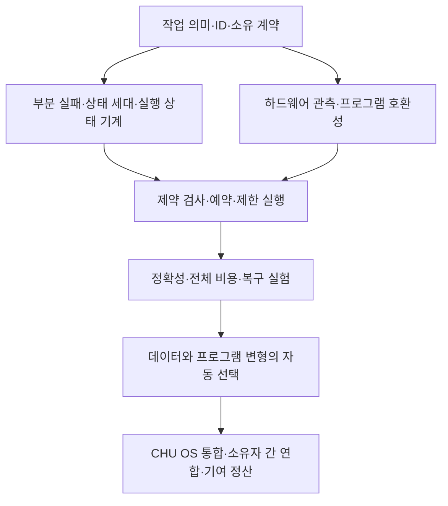

# 서버 클라이언트 이후의 OMC를 위한 지식과 설계 과제

OMC를 서버–클라이언트의 다음 아키텍처로 발전시키려면, **사용자가 요청하는 작업의 의미와 그 작업을 수행할 컴퓨터·프로그램·데이터 위치를 분리한 뒤, 검증 가능한 계약으로 다시 결합하는 능력**이 필요하다. 장비들은 작업마다 요청자·실행자·저장자·검증자의 역할을 맡을 수 있고, OMC는 그 조합과 물리 실현을 현재 조건에 맞게 바꾼다.

[사용자 발화](../records/2026-10-10/post-client-server-kubernetes/user-verbatim.txt)는 USER_PRIMARY다. 아래는 이를 구체화하는 SECONDARY_AI / PROPOSED 설계다. “다음 아키텍처”는 사용자가 제시한 개발 방향이며, 기존 모든 분산 시스템에 대한 신규성·우월성을 입증한 결론은 아니다. 앞선 [하드웨어 결합 계획](HARDWARE_SOFTWARE_FIT_PLAN.md)의 의미·연결 불변 조건을 이어간다.

## 다음이라는 말을 구현 가능한 차이로 만들기

서버와 클라이언트라는 요청·응답 역할은 개별 통신에서 계속 존재할 수 있다. OMC의 상위 모델에서는 사용자가 고정 서버 주소와 바이너리 배치를 직접 지정하지 않고, 원하는 결과와 제약을 제출하도록 설계한다. 동일한 장비가 한 작업에서는 계산을 요청하고 다른 작업에서는 데이터를 제공할 수 있다. 단, 역할의 변경은 소유권·실행 권한의 자동 이전이 아니다.

예를 들어 사용자가 “이 데이터 revision에서 이 결과를 이 시간·비용 한도 안에 구해 달라”고 요청하면, OMC는 데이터가 있는 곳으로 계산을 보낼지, 일부 데이터를 옮길지, 어떤 검증된 프로그램 변형을 사용할지 정한다. 결과에는 입력·코드 판본과 실행 근거가 붙는다. 네트워크 단절이나 장비의 기여 철회가 생기면 기존 계약에 따라 대기·재계획·복구한다.

이 구상을 판정할 세 질문은 다음과 같다.

1. 사용자의 작업 ID와 의미 관계를 바꾸지 않고 실행 장비·프로그램 변형·복사본을 바꿀 수 있는가?
2. 그 선택이 출력의 의미, 소유자의 한도와 취소 의사, 실패 복구 계약을 보존하는가?
3. 고정 배치 기준선보다 전체 비용이나 사용자의 개입을 줄였다는 근거가 있는가?

AI 호출, 클러스터 연결, 데이터 복사 성공만으로 위 세 질문에 답했다고 보지는 않는다.

## 먼저 분리해야 하는 다섯 가지

| 대상 | 식별하고 보존할 것 | 변경할 수 있는 것 |
| --- | --- | --- |
| 작업 의미 | WorkloadSpec ID·계약 revision·결과 판정법 | 허용 범위의 알고리즘·분할 방법 |
| 데이터 | 논리 자원 ID·내용 revision·출처 | 물리 복사본·캐시·전송 경로 |
| 프로그램 | 변형별 artifact digest·빌드 출처·호환 조건 | 검증된 변형 중 선택 |
| 기여 자원 | 제공자·장비 ID·사용 권한·한도·철회 조건 | 예약량·실행 시점·역할 |
| 실행 사실 | plan/run/attempt ID·관측 시각·성공 또는 실패 근거 | 새 시도의 위치와 계획 |

작업의 의미를 바꾸는 수정은 새 계약 revision이다. 하드웨어 배치 변경에 숨겨서 처리하지 않는다. `G`를 HSWM 의미 그래프, `R(t)`를 운영 실현 그래프로 두면 이번 기능의 조건은 `G_before = G_after`이고, 변화는 `R(t)`에 기록한다. 지식 자체의 학습·수정은 별도 소유 워크플로에서 새 판본을 만든다. 프로그램 변형은 서로 다른 바이트이므로 각자 식별하고 동일한 결과 계약과 연결한다.

## 필요한 지식과 만들어야 할 산출물

다음 순서는 공부할 분야의 나열과 함께, 그 지식이 어떤 설계 결정을 가능하게 해야 하는지를 제시한다. P0는 첫 실행 전, P1은 자동 적응 전, P2는 여러 소유자의 경제·연합 운영으로 확장하기 전의 우선순위다.

| ID | 지식과 우선순위 | OMC에서 결정할 문제 | 지식을 적용한 산출물과 반례 |
| --- | --- | --- | --- |
| K01 | 분산 프로그래밍 모델·타입·효과, P0 | 독립 task, 상태를 가진 actor/service, 연속 stream 중 무엇을 실행 단위로 삼을까? 무엇을 재시도해도 되는가? | WorkloadSpec, 입력·출력·부작용·취소 계약. 중복 요청이 두 번의 외부 효과를 만들지 않는 반례 |
| K02 | 이름·버전·주소·출처와 그래프 모델, P0 | 데이터의 정체성과 저장 위치를 어떻게 분리할까? 새로운 실행 variant를 무엇으로 식별할까? | 안정된 ID, revision, digest, locator, 이름 있는 참여 역할. 같은 이름의 다른 바이트를 잘못 합치는 반례 |
| K03 | 부분 실패·동시성·일관성, P0 | 관측이 늦거나 조정자 둘이 같은 자원을 선택하면 누가 확정할까? | 상태 세대 비교, 예약·lease·fencing 계약. 단절 뒤 돌아온 오래된 실행자가 새 결과를 덮는 반례 |
| K04 | 운영체제·하드웨어 구조, P0 | 실제로 쓸 수 있는 CPU·RAM·NUMA·GPU·PCIe·저장·네트워크는 무엇인가? | 물리/게스트와 cgroup 범위를 구분한 capability 및 TTL 관측. 미지원 ISA·숨은 상위 한도·메모리 대역폭 병목 |
| K05 | 스케줄링·최적화·대기행렬, P0 | 어떤 작업을 어느 장비에서 언제 실행하며 전송 비용은 얼마나 드는가? | 필수 제약 필터와 후보 점수·기준선. 연산은 빨라도 전송·대기가 커서 전체가 느려지는 반례 |
| K06 | 제어 순환·내구 실행·복구, P0 | 선언·예약·명령 접수·실제 실행·검증 완료를 어떻게 구별할까? | 상태 기계, 영속 intent, 멱등 키, 재관찰, backoff, 복구 기록. 결과 기록 직전 중단 |
| K07 | 데이터 배치·캐시·복제·상태 이전, P1 | 데이터를 옮길지 계산을 옮길지, 활성 상태를 어디서 끊고 재개할지? | 분할/복원·일관된 snapshot·체크포인트 계약. 같은 제공 호스트의 두 디스크를 독립 장애 복제본으로 오인하는 반례 |
| K08 | 컴파일러·ABI·수치 정확성·재현 빌드, P1 | 어떤 하드웨어별 프로그램 변형이 같은 의미를 구현하는가? | 소스·도구chain·라이브러리·드라이버 핀, variant registry, correctness oracle. SIMD/정밀도 변경 후 허용 오차 초과 |
| K09 | 관측·성능 실험·원인 분석, P0 | 개선이 실제 실행 방식 때문인가, 캐시나 다른 부하 때문인가? | warm/cold 조건·반복·오류율·p95·전송/메모리 관측. 성공한 시도만 골라 평균을 좋게 보이는 반례 |
| K10 | 학습 기반 결정·피드백 제어, P1 | 어떤 후보를 언제 탐색하고 언제 기존 배치를 유지할까? | AI 제안과 결정적 적격성 검사 분리, 예산·불확실성·최소 유지 시간. 작은 부하 변화마다 왕복 재배치하는 반례 |
| K11 | 신뢰 경계·권한·프로세스 격리, P0 | 누가 어떤 코드와 데이터에 접근하며 원격 결과를 어디까지 믿을까? | 장비/사용자/실행자 ID, 제한 권한, 소유 실행기, 감사 근거. 자원 제공만으로 임의 코드를 실행할 권한을 얻는 반례 |
| K12 | 기여 계량·합의·정산, P2 | 실제 유용한 기여를 어떻게 인정하고 이중 보상·기여 철회를 다룰까? | 작업 계약과 검증 결과에 연결된 기여 receipt, 분쟁·정산 상태. 토큰 개수나 사용 CPU 시간만 늘려 보상을 얻는 반례 |

K01–K06·K09·K11이 첫 실행의 토대다. K07·K08은 그 위에 데이터와 프로그램의 적응 범위를 넓히고, K10은 검증 가능한 후보가 생긴 후 선택을 학습한다. K12의 사용 한도·동의·철회는 처음부터 모델에 넣되, 거래 가능한 코인의 발행·가치·정산 프로토콜까지 첫 실험에 묶지는 않는다.

## 지식 사이의 실제 의존 관계

**의미 계약 → 변형 검증 → 후보 선택**의 순서를 지킨다. 일반적인 모든 프로그램의 동등성을 AI가 보장한다고 가정하지 않고, 처음에는 판정 가능한 작업과 허용된 변형으로 범위를 정한다. **장비 관측 → 자원 예약 → 실행 직전 재검사**도 분리한다. 현재 가용량을 읽었다는 사실만으로 자원을 확보한 것은 아니다.

전역적으로 합칠 필요가 없는 관측·후보·학습 근거는 소유 범위에서 축적할 수 있다. 반면 배타적 자원 예약, 활성 상태의 소유 이전, 동일 작업의 최종 결과 확정, 중복 보상 방지는 충돌 해결 계약이 필요하다. 모든 상태를 하나의 전역 합의로 묶는 방식과 모든 충돌을 사후 병합으로 해결한다는 방식 사이에서, **어떤 상태가 누구의 책임으로 직렬화되어야 하는지**부터 정한다.

처음 구현은 한 소유 영역의 단일 조정자와 기존 실행기를 사용한다. 이후 여러 소유 영역으로 확장할 때 각 영역의 자원 약속·취소·실패 의미를 명시한다. 동일한 조정 소프트웨어가 여러 곳에 설치되었다는 사실만으로 분산 합의나 무신뢰 P2P 검증이 완성되지는 않는다. 이는 초기 구현을 단순하게 유지하면서 미래의 연합 경계를 보존하는 설계 선택이다.

## 기존 연구에서 가져올 지식

| 자료 | 이번에 확인한 범위 | 가져올 학습 과제 |
| --- | --- | --- |
| [Kubernetes 고정 코드 분석](KUBERNETES_SOURCE_ANALYSIS.md) | 공식 Git snapshot의 선택 구간 직접 읽기 | desired/observed 분리, 재관찰·조건부 갱신, Filter/Score, 예약 해제, 실제 실행과 완료 분리 |
| [Borg, Verma 외, EuroSys 2015](https://research.google/pubs/large-scale-cluster-management-at-google-with-borg/) | 저자 측 초록·서지 | 선언적 작업, admission, 작업 배치와 프로세스 수준 자원 격리를 함께 설계하는 관점 |
| [Omega, Schwarzkopf 외, EuroSys 2013](https://research.google/pubs/omega-flexible-scalable-schedulers-for-large-compute-clusters/) | 저자 측 초록·서지 | 공유 상태를 보는 여러 스케줄러의 낙관적 동시성·충돌 비용을 별도 연구. 이것만으로 비잔틴 내성이나 무합의를 증명하지 않음 |
| [Ray, Moritz 외, OSDI 2018](https://www.usenix.org/conference/osdi18/presentation/moritz) | 학회 초록·서지 | task와 actor를 구분하면서 하나의 실행 모델로 연결하는 선례. CHU와 동일한 존재론이라고 합치지 않음 |
| [Linux NUMA memory policy](https://docs.kernel.org/admin-guide/mm/numa_memory_policy.html) | BIND·PREFERRED·INTERLEAVE 정책 설명 | 계산 위치와 메모리 할당 위치를 함께 관측·비교. 다른 컴퓨터의 RAM을 하나의 동일한 주소 공간으로 간주하지 않음 |
| [LLVM Auto Vectorization](https://llvm.org/docs/Vectorizers.html) | 비용 모델·벡터 폭·변환 제약 설명 | 최적화 선택에도 비용과 의미 제약이 필요함. OMC는 검증된 빌드 변형의 선택부터 시작 |

위 논문들의 초록을 읽은 범위에서 학습 연결을 만들었으며, 논문 전체 재현·성능 수치의 재검증은 이번 결과에 포함하지 않는다. OMC에 대한 적용 판단은 별도의 제안이다.

## 쿠버네티스에서 흡수할 부분과 OMC가 추가할 부분

쿠버네티스의 제어 원리를 네이티브 실행 모델에도 적용할 수 있다는 것이 이번 설계 판단이다. 다만 kubelet 실행 경로는 Pod·sandbox·container runtime 계약에 맞춰져 있으므로, 해당 바이너리를 그대로 쓰면 일반 네이티브 프로세스 실행기가 된다고 볼 수는 없다. 구체적인 근거는 [코드 분석](KUBERNETES_SOURCE_ANALYSIS.md)에 있다.

| 역할 | 가져올 원리 | OMC가 명시해야 할 추가 계약 |
| --- | --- | --- |
| 작업 접수 | 구조화된 선언과 검증 | 결과 의미·정확성·비용·기여자 한도 |
| 상태 저장 | 판본·조건부 갱신·관측 구분 | HSWM 의미 그래프와 물리 실현 그래프의 경계 |
| 조정자 | 큐·재관찰·재시도·수렴 | 작업별 부작용과 최종 결과 확정 조건 |
| 계획기 | 필수 제약 필터와 후보 점수 | 프로그램 변형·데이터 위치·장비의 공동 선택 |
| 장비 실행기 | 배정 관측·로컬 상태 관리 | OS별 네이티브 프로세스, 취소·복구·fencing, 드라이버·ABI |
| 연결 경로 | 서비스 식별과 실제 endpoint의 분리 | USL 의미 ID 보존, 경로 변경의 관측과 실패 처리 |
| 결과 피드백 | 실행 상태와 관측 기록 | 정확성 검증·전체 비용·AI 결정 판본·검증된 기여 receipt |

## 첫 수직 실험의 구체적인 범위

첫 실험 제안은 **고정 정수 데이터 조각의 집계 작업**이다. 정수 폭·overflow 처리·청크 경계·출력 순서·내용 digest를 계약에 명시한다. 이 작업을 선택하는 이유는 같은 결과인지 독립적으로 판정하기 쉽고 외부 부작용을 제한할 수 있기 때문이다. CHU의 전체 인지 작용을 이 예제로 환원하지 않는다.

1. 호환성이 관측된 두 장비와 두 프로그램 변형을 등록한다. 첫 비교에서는 이미 빌드·검증된 변형을 쓰고, AI가 실행 중 원문 코드를 임의 수정하지 않는다.
2. 동일 입력에 대해 고정 배치, 규칙 기반 locality 배치, AI 후보 배치를 비교한다. 실행기·검사기·예산·입력은 동일하게 유지해 AI 기여를 구별한다.
3. 입력 이동·준비·대기·실행·검증·복구까지 총 시간을 기록한다. warm/cold 조건과 다른 부하를 구별하고, 작은 작업에서 계획 비용이 계산 비용보다 커지는 경우도 포함한다.
4. 중복 요청, 관측 만료, 장비 단절, 예약 충돌, 완료 직전 중단, 나쁜 프로그램 변형을 주입한다. 출력 계약·작업 ID·USL 의미 관계가 보존되는지 확인한다.
5. 정확성과 복구가 통과한 뒤에만 적응을 자동화한다. 개선이 없으면 고정 기준선을 유지하고 그 결과를 실패 없이 기록한다.

성공 조건은 작업 계약 보존, 충돌 시 단일 결과 확정, 비용과 개입 빈도의 비교 가능성이다. 첫 실험 전에 구체적인 반복 횟수·예산·개선 문턱을 정한다. 지금 임의의 성능 수치를 성공 결과로 제시하지 않는다.

## 그래프와 연구 배치

[지식 그래프](../graph/post-client-server-knowledge.json)는 `사용자 근거 → 설계 질문 → 필요한 지식 → 산출물 → 평가`를 연결하고, 코드 분석 주장은 고정 commit·파일·실제로 읽은 줄 구간에 연결한다. 의존 관계의 순환 검사는 지식 선행 관계에만 적용한다. 근거가 있는 코드 분석과 아직 평가하지 않은 OMC 설계는 다른 상태다.

기존 `kubernetes` 주제의 WHAT_IS에는 코드 동작 분석을, `infrastructure-orchestration` 주제의 HOW_TO에는 이 지식·구축 계획을 누적한다. 기존 모듈 UID와 역사적 연구를 보존하며, 새 정체성이나 공유 KG 정전을 이 분석으로 확정하지 않는다.
