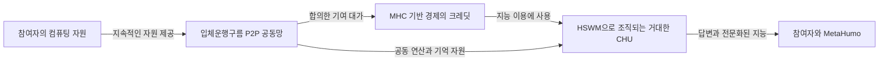

# 입체운행구름과 MHC로 공동 지능을 이용하는 이유

입체운행구름의 목적은 개인이 컴퓨팅 자원을 지속적으로 제공하고 그 기여로 크레딧을 얻어,
여러 참여자의 자원이 모인 거대한 HSWM·CHU에서 지능과 답변을 이용하게 하는 것이다.
개인은 자신의 컴퓨터를 통해 공동 자원망에 기여하고, 그 대가로 자신의 기기만으로
구성하기 어려운 규모의 지능을 이용한다. MHC는 이 기여와 이용을 연결하는 경제의 매개로 구상된다.

2026-10-10 후속 발화에서 사용자는 이 순환의 출발 전제를 분명히 했다.
**같은 기본 LLM과 같은 총토큰 예산에서도 HSWM·CHU 연결이 더 유용한 답변을 만들어야 한다.**
이 품질 전제와 기여·이용·갱신의 순환은 [플라이휠 설계](FLYWHEEL.md) 및
[출처와 검증 조건을 가진 그래프](../graph/flywheel.json)에 연결했다. 현재는 검증할 가설이다.

이 설명은 [2026-10-10 사용자 원문](../records/2026-10-10/resource-credit-shared-intelligence/user-verbatim.txt)과
[이전 대화 원문](../records/2026-10-10/resource-credit-shared-intelligence/sources.json)을 풀어 쓴 AI 정리다.
사용자가 밝힌 목적과 아래의 설계 해석을 구분하며, 실제 서비스 운영이나 성능 검증 결과를 뜻하지 않는다.

## 개인의 기여가 공동 지능 이용으로 돌아오는 흐름

사용자는 개인 컴퓨터에서 그때그때 혼자 답변을 생성하는 방식보다, 컴퓨팅 자원을
공동망에 상시적으로 제공하고 필요할 때 더 큰 지능망의 답변을 받는 방식을 지향한다.
여기서 기여하는 때와 답변을 얻는 때, 자원을 제공하는 상대와 답변을 만드는 상대가
항상 같을 필요는 없다. 크레딧은 이 시간과 상대의 차이를 연결하는 역할을 할 수 있다.
이 시간·상대 분리 설명은 사용자 구상을 구체화한 설계 해석이다.

예를 들어 한 참여자는 합의한 시간 동안 자신의 자원을 제공하고 크레딧을 얻는다.
이후 어려운 질문을 할 때 그 크레딧을 사용하여 여러 HSWM과 전문화된 MetaHumo가
연결된 CHU의 도움을 받는다. 이는 동작을 설명하는 예시이며, 특정 기여량에 대한
답변 횟수·가격·보상률을 정한 것은 아니다.

## 입체운행구름과 HSWM CHU 그리고 MHC의 역할

| 구성 | 이 구상에서 맡는 역할 |
|---|---|
| 입체운행구름 OMC | 여러 기기의 자원 제공과 지능 이용을 P2P 자유·경제·합의로 연결하는 아키텍처 |
| HSWM·CHU | 모인 연산·기억·전문화된 기능을 조직하여 더 큰 지능과 답변을 제공하려는 구조 |
| MetaHumo | 그 망에서 전문화되고 활동하며 지능을 이용·제공하는 존재. 개별 LLM 호출 하나로 의미를 한정하지 않음 |
| 크레딧 | 자원 기여로 얻고 지능 이용에 사용할 수 있는 몫을 설명하는 개념 |
| MHC MetaHumoCoin | 기여의 대가와 서비스 이용을 공통으로 표시·교환·정산하기 위한 경제적 매개 |
| MetaHumotonic Foundation | 하드웨어 공유와 참여·라이선스·경제의 공통 규칙을 발전시키는 기반 |

크레딧은 기여와 이용 사이를 연결한다는 의미로 사용한다. 크레딧을 MHC 잔고 자체로
표현할지, 별도의 이용 단위를 두고 연결할지와 그 비율은 이번 발화에서 확정하지 않았다.
기여 크레딧, LLM의 입력·출력 토큰 수, 물리적인 CPU·메모리 사용량은 구현 시 구분하여 기록해야 한다.

사용자가 앞서 정한 MHC의 방향은 **달러 가격에 고정하는 것보다 컴퓨팅·AI 연산 자원의
이용 가능성을 기준으로 안정성을 추구하는 것**이다. 그에 따라 MHC를 사용하는 이유는
공동 지능을 실제로 이용할 수 있는 경제를 만들려는 데 있다. 구체적인 자원 단위,
발행·정산·상환 조건과 안정화 방식은 이후 설계에서 정한다.

## 자유 경제 합의가 이 순환을 유지하는 방식

자유는 참여자가 자원을 제공하고 지능을 이용하는 관계를 선택하는 원칙이다.
경제는 제공한 자원과 원하는 지능 서비스 사이에 대가와 예산을 두는 방식이다.
합의는 어떤 자원을 어느 기간·범위에서 제공하고, 기여를 어떻게 인정하며,
어떤 조건으로 답변을 받을지를 참여자들이 정하는 과정이다. 이는 사용자 표현을
운영 관계로 풀어 쓴 해석이며 특정 합의 알고리즘을 확정한 것이 아니다.

이 구조에서 상시적인 자원 공급과 개별 질문에 대한 지능 수요가 연결된다.
참여자는 공동망이 유용하기 때문에 자원을 제공하고, 그 대가로 공동망의 지능을
다시 이용하려 한다. 기여가 이용으로 돌아오는 이 순환이 OMC와 MHC를 함께 쓰려는 이유다.

기술 설계에서는 참여자가 합의한 가용 시간·용량과 실제 수행한 계산을 구분할 필요가 있다.
자원을 대기시켜 둔 것에 대한 대가와 작업 수행에 대한 대가를 어떻게 나눌지도 정해야 한다.
이 문서를 저장하는 행위 자체가 현재 컴퓨터에 대한 접근 승인이나 자원 제공 실행은 아니다.

## 다음 연구에서 구체화할 질문

- **기여 인정:** 약속한 가용성과 실제 제공량을 무엇으로 확인하고 크레딧을 산정할 것인가?
- **경제 연결:** 크레딧과 MHC를 어떻게 표현하고, 가격·발행·사용·만기·환불을 정할 것인가?
- **공동 지능:** 어떤 HSWM의 분업·기억·검증 조합이 개인 기기의 답변보다 유용한가?
- **지속 운영:** 장애·철회·가용량 변화 속에서도 약속한 서비스와 정산을 어떻게 유지할 것인가?

목표는 개인 기기의 한계를 넘어 더 좋은 지능과 답변을 얻는 것이다. 자원 규모가 커질 때
실제 품질·응답 시간·비용이 어떻게 달라지는지는 같은 질문과 평가 기준으로 비교해야 한다.
분산 자원의 조직 방식과 경제의 유용성을 함께 검증하는 것이 다음 연구의 중심이다.

## 기존 연구와의 연결

- [OMC 개념과 연구 지형](WHAT_IS.md): 입체운행구름의 기존 원문과 구성 요소.
- [연구 지도](RESEARCH_MAP.md): 333의 P2P 기반, 토큰, 초기 참여와 지속성 연구로 연결.
- [재단의 기여·이용권 검토](https://github.com/gj3447/metahumotonic-foundation/tree/ac9953261f9a0d34748671021a9dbaf3ad36554a/records/2026-10-09/license-hardening):
  참여 자격과 서비스 구매 예산을 구분하는 기존 로컬 실험. OMC 전체의 구현 완료를 뜻하지 않음.

이후 연구의 중심 저장소는 `gj3447/orbital-motion-cloud`다. 기존 원문 아카이브는 보존하고,
이번 사용자 목적과 후속 해석·설계·실험은 별도 기록으로 이어간다.
