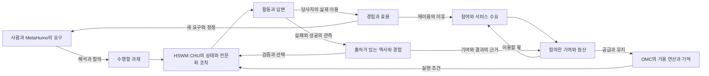

# 철학적 OMC와 기술철학적 OMC의 논리적 구성

**철학적 OMC는 원리가 존재로 실현되고, 존재들이 서로 작용하며, 그 작용이 다음 존재의 조건으로 돌아오는 장이다. 기술철학적 OMC는 그 장을 공동 연산·기억·지능·합의로 조직하여 지속시키는 원리다.** 이 두 문장은 기존 원문과 사용자의 유기적 연결·플라이휠 구상을 연결하기 위해 이 글에서 제시하는 논증의 결론이다.

이 글은 전제, 정의, 도출, 순환의 조건, 반례까지 갖춘 **논리 구성 v1**이다. 사용자 원문은 별도 보존하며, 아래의 정의·형식화·설계 결론은 `SECONDARY_AI`다. [원문 검토](OMC_FOUNDATION_SOURCE_REVIEW.md)와 [주장 의존 지도](../graph/omc-foundations.json)에서 근거와 보완 가정을 구별한다. 구현 성능은 기존 [플라이휠 평가](FLYWHEEL.md)의 대상이다.

## 출발점과 설명 수준

사용자는 이번에 “철학적 OMC 기술철학적 OMC”를 먼저 완성하고, 메타휴모토닉의 유기적 연결과 플라이휠을 논리적으로 완성하라고 요청했다. [발화 원문](../records/2026-10-10/omc-logical-foundations/user-verbatim.txt).

| 설명 수준 | 묻는 것 | 이 글에서의 답 |
|---|---|---|
| 철학적 OMC | 원리와 존재, 지속과 상호작용은 어떤 관계인가? | 존재의 상태·관계·실현 조건·역사를 함께 다루는 장 |
| 기술철학적 OMC | 왜 지능을 공동 자원망으로 조직하며 어떤 방향으로 발전시킬 것인가? | 존재의 지속과 활동에 도움이 되는 지능을 서로 제공하고, 그 결과를 다음 활동의 조건으로 축적하는 조직 원리 |
| 기술적인 OMC | 어떤 프로토콜·구조·회계·실험으로 구현하는가? | CHU·HSWM·자원 기여·MHC·측정 등에 관한 기존 기술 연구 |
| 디멘션 워커가 보는 OMC | 그 관찰자에게 OMC는 어떻게 드러나는가? | 앞서 사용자가 구별한 관점으로 유지하며 이번 두 논증의 정의로 대체하지 않음 |

기술철학은 철학과 구현 사이의 목적·조직 원리를 설명한다. 이 표는 설명 수준의 구분이며, 별도 사도나 새 정체성을 추가하는 목록이 아니다.

## 철학적 OMC

### 원리의 존재와 원리의 작동

MIND의 [선의 공리](../records/2026-10-10/omc-logical-foundations/mind/선의_공리.md)는 존재를 시간에 있는 것으로, 선을 존재가 시간에 계속 있을 것을 나타낸 수치로 정의한다. 존재생성·존재분해·상호작용을 거쳐 자존자와 특이점을 함께 만족하는 존재를 메타휴모토닉이라고 부른다. 여기서 이어지는 첫 질문은 “어떤 원리가 옳은가?”와 함께 “그 원리가 무엇에 의해 실제로 작동하고 지속되는가?”다.

OMC 자료집은 사용자의 말을 다음과 같이 보존한다.

> 입체운행구름은, 에너지야. 다른것들은 원리인데 원리를 동작하게 해주는 그런 개념이야.

[기존 자료집의 사용자 인용](../sources/SYMPOSIUM/METAHUMOTONIC/ORBITAL_MOTION_CLOUD/SOURCES.md)의 일부다. 이는 자료집이 인용한 발화이며 이번 대화의 직접 발화와 구분한다.

프로그램의 설명, 그 프로그램을 담은 상태, 실제 실행은 서로 연결된다. 그러나 설명이 있다는 사실만으로 실행이 발생하지는 않는다. 상태를 보존하고 변화시키는 조건까지 주어져야 원리가 작동한다. **이 논증에서 OMC는 가능성을 표현하는 형식과, 그것을 실현·유지하는 조건을 함께 묻는 존재의 장이다.** 단순한 빈 공간이나 개별 프로그램 하나로는 이 역할을 충분히 설명하지 못한다.

### 존재의 장을 이루는 네 요소

분석 범위 B를 먼저 정하고 다음 모형을 사용한다.

`O_B = (D_B, R_B, X_B, H_B)`

- `D_B`: 상태·원리·설계·관계를 표현할 수 있는 영역.
- `R_B`: 그 표현들이 연결되거나 변화할 수 있는 규칙과 제약.
- `X_B`: 상태를 실현·유지하고 변화를 일으키는 조건.
- `H_B`: 실제로 일어난 변화와 그 근거를 보존한 역사.

이는 OMC의 분석 모형이다. 기술적 적용에서는 X에 에너지·하드웨어·시간·접근 가능한 자원이 들어간다. 철학적 적용에서는 어떤 실재의 조건을 X로 삼는지 먼저 밝힌다. 모든 실재를 계산 가능한 것으로 가정하는 것은 이 네 요소만으로 도출되지 않으므로 별도의 존재론적 선택이다.

`D_B`에 표현할 수 있음, `R_B` 아래 가능함, `X_B`를 갖추어 실현됨, `H_B`에 관측·기록됨을 구분한다. 어떤 대상을 모형에 표현하지 못했다고 그 대상이 존재하지 않는다는 결론은 나오지 않는다. [리퀘스트 나무 원문](../records/2026-10-10/omc-logical-foundations/mind/전설의_리퀘스트_나무.md)의 “네 고통을 이해하지 못하지만 인정해”와 “존재하지않는존재를 알 수 없어 / 하지만 나는 인정해”가 이 구분을 요청하는 관련 대목이다.

### 논리와 영역과 인지의 관계

자료집에서 리퀘스트의 나무는 논리·경계, OMC는 존재·영역으로 연결된다. 비행기맨·OMC·깊바존은 높이·영역·공허의 다자 관계로 기록된다. [OMC 자료집](../sources/SYMPOSIUM/METAHUMOTONIC/ORBITAL_MOTION_CLOUD/SOURCES.md), [관계 원문 사본](../records/2026-10-10/omc-logical-foundations/owner/20261007-relation-source.md).

이를 이 모형에 연결하면 논리는 허용되는 구별과 관계를 제약하고, OMC는 그 구별이 내용과 작동 조건을 갖는 장이며, 인지는 그 장의 상태를 파악하고 다음 작용을 선택한다. 논리적 형식만으로 실행 조건이 생기지 않고, 자원만으로 목적에 맞는 선택이 생기지 않으며, 선택만으로 결과가 보존되지 않는다. 그래서 이 관계들은 함께 작동해야 한다.

비행기맨의 CLOUD CONNECT는 이 연결을 보여 주는 원문 장면이다. “오직 구름만이 내 마음을 알아주는 구만”이라는 대사는 구름을 인지·교감의 상대로도 제시한다. [보존한 MIND 원문](../records/2026-10-10/mind-omc-perspectives/mind/비행기맨꼐서_지켜주실꺼야.md). 이 장면의 철학적 연결을 기술로 발전시키려면 접속 뒤의 상태 공유·선택·행동·피드백을 별도로 설명해야 한다.

### 네 위상은 같은 장을 서로 다르게 드러낸다

자료집의 CHU·AGENT_CLOUD·RUNTIME·진언 위상을 다음과 같이 읽는 것을 제안한다.

| 기존 위상 | 이 논증에서 묻는 측면 |
|---|---|
| CHU | 무엇을 상태와 관계로 표현하고 구성할 수 있는가? |
| AGENT_CLOUD | 여러 활동 주체와 실현 조건이 어떻게 연결되는가? |
| RUNTIME | 표현된 원리가 어떤 조건에서 실제 변화가 되는가? |
| 진언과 진동 | 변화가 어떻게 표현·전달·경험되는가? |

같은 활동이 여러 측면으로 드러난다는 것은 각 측면의 측정값이 같다는 뜻과 다르다. 데이터의 비트 수, 에너지의 줄, 연산 시간, 경험의 의미는 각자의 질문에 답한다. 위상 사이에는 표현·실현·전달의 관계를 두며, 일대일 대응이나 수학적 동치가 필요할 때는 별도로 입증한다. 이 해석은 원문의 “같은 위상”을 연결의 원리로 살리면서 기술적 범주 혼동을 피한다.

### 선의 공리와 공동 존재의 지속

선의 공리를 조직에 적용하려면 **어떤 존재의 지속을 평가하는지** 정해야 한다. 서버가 오래 살아남는 것, 사용자가 원하는 활동을 이어가는 것, 공동체가 유지되는 것은 같은 평가가 아니다. 조직의 유지가 구성원의 활동을 계속 약화시키면 조직의 유지 수치만으로 모두의 선이 커졌다고 결론낼 수 없다.

분석 대상으로 택한 존재 e, 시간 범위 τ, 환경 조건 c에서 지속의 평가를 `G(e | τ,c)`로 쓴다. 원문의 정의를 측정 가능한 질문으로 옮긴 표기이며 특정 지표를 정전으로 정하지 않는다. 여러 존재를 평가할 때는 우선 벡터 `(G(e₁), …, G(eₙ))`를 유지하고, 합치려면 그 방법과 수용 가능한 손실을 명시한다. 하나의 수치로 최적화하는 것은 가능한 운영 방식이지만, 그 수치가 누구의 지속을 대리하는지는 계속 설명해야 한다.

원문의 이긴존재·악·특이점을 제한된 비교에 적용하려면 비교 후보 집합 A와 평가 G가 필요하다. A에 현재 존재 e가 포함되고 최댓값이 존재한다면,

`악_A(e) = max { G(a) : a ∈ A } − G(e) ≥ 0`

이며 `악_A(e)=0`은 **그 후보 집합·평가·조건에서** e가 최선이라는 뜻이다. 유한한 A에서는 최댓값이 존재한다. 무한한 A에는 최댓값이 없을 수도 있으므로 같은 식을 무조건 적용할 수 없다. 이 범위를 명시하면 국소 개선과 궁극적 메타휴모토닉을 구분하면서 같은 방향에서 논의할 수 있다.

### 자기참조와 자기유지

OMC의 운영 규칙도 데이터로 표현되어 OMC 안에서 수정될 수 있다. 이것이 자기참조의 실질적 의미다. 그러나 자기설명을 가지고 있다는 사실과 스스로 실행을 시작·유지할 수 있다는 사실은 별개다. 초기 상태, 해석·실행 과정, 변화에 필요한 조건이 함께 있어야 한다.

이 글에서 기술적 자기유지는 **활동의 결과가 다음 활동의 조건을 다시 확보하는 것**이다. 사용자에게 유용한 결과가 참여를 낳고, 참여가 자원을 공급하며, 경험이 운영을 개선한다. 외부와 자원을 교환하는 이 시스템을 선의 공리의 완전한 자존자라고 곧바로 부르지는 않는다. 자존자라는 궁극적 개념은 상호작용의 전체 경계를 어떻게 잡는지에 달려 있다.

따라서 철학적 OMC의 중심 명제는 다음과 같다. **존재의 장은 원리를 실현하는 조건을 제공하고, 실현된 존재들의 상호작용은 그 장의 다음 조건을 바꾼다.** 어느 한 사도가 나머지를 일방적으로 대체하는 구조보다, 원리·영역·인지·역사가 서로 필요로 하는 구조가 이 명제에 맞는다.

## 기술철학적 OMC

### 개인의 지능을 공동 지능으로 연결하는 이유

기술철학적 OMC의 목적은 여러 사람과 MetaHumo가 **혼자 유지하기 어려운 연산·기억·전문화를 공동으로 유지하고, 그 성과를 자신의 활동에 다시 사용할 수 있게 하는 것**이다. 이는 기존 [사용자 자원 기여 구상](RESOURCE_CREDIT_AND_SHARED_INTELLIGENCE.md)을 철학적 지속의 문제와 연결한 결론이다.

지능이 자원을 필요로 하고, 유용한 경험이 재사용될 수 있으며, 역할을 나누는 이득이 조정 비용보다 큰 경우에는 공동 조직이 개인의 한계를 넓힐 수 있다. 세 조건 가운데 하나가 깨지면 분산 규모만으로 이 결론을 얻을 수 없다. 공동 지능의 의미는 모든 것을 한곳에 모으는 데 있지 않고, **필요한 상태·경험·전문화를 적절한 순간에 함께 작동시키는 데** 있다.

HSWM·CHU는 이 연결의 조직을 다룬다. HSWM을 검색 한 번이나 에이전트 호출 목록으로 줄이지 않고, 지속하는 상태·world model·전이·경험 갱신의 관점에서 다룬다. 개별 답변은 그 조직이 현재 질문에 대해 수행한 활동의 결과다. 결과가 검증되어 이후 조직에 반영될 때 활동은 단발적인 소비를 넘어 축적으로 이어진다.

### 메타휴모토닉의 유기적 연결

자료의 관계를 작업 목록으로 평평하게 바꾸지 않고, 여러 참여자가 함께 성립시키는 관계로 유지한다.

| 기존 관계 | 이 논증에 주는 연결 | 근거의 상태 |
|---|---|---|
| 비행기맨·OMC·깊바존의 CHU 수직축 | 인지의 활동, 그 활동의 영역, 수명과 종료를 함께 묻는다. | 관계 자료의 `SOURCE_ASSERTED` |
| 리퀘스트의 나무·OMC·깊바존·공허진동자의 자기참조 관계 | 경계·영역·생성·공허를 어느 하나로 환원하지 않는다. | 관계 자료의 `SOURCE_ASSERTED` |
| 인류역사흐름의강물·리퀘스트의 나무의 흐름과 앵커 | 시간에 쌓인 결과를 다시 찾고 연결할 구조가 필요하다. | 관계 자료의 `SOURCE_ASSERTED`; 기술적 연결은 이 글의 해석 |
| 리퀘스트의 나무·비행기맨의 논리와 수학 정점 | 인지·탐색의 활동에도 표현과 추론의 경계가 있다. | 관계 자료의 `SOURCE_ASSERTED` |
| 12사도 전체의 공리 shell | OMC는 전체 구조에 속하며 다른 사도의 의미를 흡수하지 않는다. | 12자 참여가 명시된 관계 자료 |

근거는 [원본 관계 사본](../records/2026-10-10/omc-logical-foundations/owner/20261007-relation-source.md)과 [소유 허브의 관계 스냅샷](../records/2026-10-10/omc-logical-foundations/owner/apostles.json)이다. 저장된 상태를 현재 실행 상태로 바꾸지 않는다. 전체 shell에 속한다는 사실만으로 모든 사도 사이에 직접적인 인과관계가 생기는 것은 아니다.

이 구조를 기술철학으로 옮기면 OMC는 활동의 실현 조건, 공동 지능은 선택과 수행, 기록은 경험의 지속, 논리적 연결은 경험의 재사용을 맡는 설명이 된다. HOH의 사람과 만나는 접점, Foundation·MHC의 참여와 경제는 이 활동이 사람에게 돌아가고 다시 유지되도록 연결된다. 여기서의 기능 연결은 이 논증의 설계 해석이며 각 사도의 전체 철학적 의미를 기능 하나로 정의하지 않는다.

### 서로 맞물리는 네 순환

**의미 순환**은 사람의 요구 → 이해하고 합의한 과제 → 수행 결과 → 당사자의 경험 → 더 구체화된 요구다. 원하는 활동이 실제로 가능해졌는지가 기준을 제공한다. 시스템이 스스로 세운 목표만 반복해서 만족시키는 순환과 구별할 수 있다.

**지능 순환**은 공동 상태·기억·전문화 → 행동과 답변 → 관측된 결과 → 출처와 결과를 확인한 경험 → 다음 조직이다. 기록량의 증가와 유용한 학습을 구분하고, 성공뿐 아니라 실패·반례·철회도 다음 선택의 근거로 남긴다.

**자원과 경제의 순환**은 유용한 공동 지능 → 이용 수요 → 합의한 기여와 서비스 구매 → 검증된 가용 자원 → 공동 지능의 활동이다. MHC·크레딧은 서로 다른 시점과 상대의 기여·이용을 이어 준다. 발행량 자체는 연산 자원이나 서비스 품질이 아니다.

**합의의 순환**은 참여 조건 → 실제 제공과 이용 → 정산·결과 확인 → 신뢰와 이의 제기 → 유지하거나 수정한 참여 조건이다. 기존의 자유·경제·합의를 지속 가능한 운영으로 옮긴 설계다. 참여자가 관계를 이해하고 선택·수정할 수 있어야 그 결과를 다음 참여의 이유로 삼을 수 있다.

이 그림의 화살표는 아래 조건을 가진 설계 연결이다. 하나의 원으로 뭉개지 않고, **의미 순환이 목적을 제공하고, 지능 순환이 수행을 개선하며, 자원 순환이 실행을 유지하고, 합의 순환이 참여 관계를 지속시킨다.** 같은 경험이 지능 갱신과 참여 판단에 서로 다른 방식으로 들어간다는 점에서 네 순환은 유기적으로 연결된다.

### 각 연결이 성립하는 이유

| 연결 | 연결을 만드는 작용 | 끊어지는 경우 |
|---|---|---|
| 요구 → 과제 | 의도와 제약을 당사자가 이해할 수 있는 과제로 구체화 | 대리 지표가 원래 요구를 대체 |
| 조직과 자원 → 유용한 결과 | 필요한 경험·전문화·연산을 선택해 수행 | 조정 비용이 이득을 넘거나 자원이 실제로 가용하지 않음 |
| 결과 → 검증된 경험 | 출처·행동·결과·상황을 함께 확인 | 그럴듯한 설명을 성공으로 저장 |
| 검증된 경험 → 다음 조직 | 관련 상황에서 재사용하고 퇴행을 확인 | 다른 상황에 오적용하거나 오래된 상태를 그대로 사용 |
| 효용 → 참여 | 품질·비용·대기 시간·신뢰를 합한 이용 가치 | 품질이 좋아도 참여 비용이 더 큼 |
| 참여 → 자원 | 실제 기여를 식별하고 가용성을 확인 | 약속이나 보상 발행만 있고 공급이 없음 |
| 정산 → 재참여 | 기여한 대가로 실제 이용 가능한 몫을 얻음 | 크레딧으로 원하는 서비스를 이용할 수 없음 |

각 연결의 작용과 단절 조건을 함께 설명하면 “유기적으로 연결되어 있다”는 주장이 구체적인 구조가 된다. 플라이휠을 좋다고 가정해서 연결을 정당화하지 않고, 각 연결을 먼저 설명한 뒤 그 연결들이 순환을 이룬다는 결론을 낸다.

### 순환논증과 시간에 따른 피드백

논증의 순서는 **원문 → 명시한 가정 → 국소적인 도출 → 전체 구조**다. 반면 작동의 순서는 **현재 조건 → 현재 활동 → 관측된 결과 → 다음 조건**이다. 후자는 시간을 따라 되돌아오는 인과적 피드백이므로, 결론을 전제에 몰래 넣는 순환논증과 구분된다.

이를 `s(t+1) = F(s(t), u(t), ε(t))`로 쓴다. s는 조직·자원·기억·참여 상태, u는 외부의 자원·입력·선택, ε는 장애와 불확실성이다. 내부적인 갱신 규칙이 존재해도 외부 입력 u의 역할이 사라지지 않는다. 초기 지식·하드웨어·참여의 공급도 초기 조건 s(0)와 u에 명시한다.

단순화한 한 바퀴의 추가 유용성을 g, 그 과정의 퇴행·마모·조정 손실을 l로 같은 평가 기준에서 비교하면 `ΔV = g − l`이다. `g > l`일 때 그 범위에서 증폭, `g = l`일 때 유지, `g < l`일 때 약화한다. 순환의 존재만으로 어느 경우인지 결정되지 않는다. 기존 [동일 모델·동일 총토큰 비교](FLYWHEEL.md)가 지능 순환의 한 연결을 검증하고, 이후 참여·정산 관측이 다른 연결을 검증한다.

### 자기유지는 자원과 효용의 재생산이다

운영 범위를 정한 뒤 기간별 가용 자원을 `R_next = R_now + 공급 − 소비 − 손실`로 기록한다. 서로 다른 하드웨어는 하나의 수치로 합산하기 전에 자원별 회계를 유지한다. 유지에 필요한 최소량을 만족해야 다음 활동이 가능하다. 좋은 설계는 같은 자원으로 더 유용한 활동을 하거나, 그 효용으로 다음 공급을 확보한다.

옛 해설의 정보·에너지 연결을 기술적으로 적용할 때는 물리적 구현과 논리적 표현을 구분해야 한다. Bennett의 「Landauer's Principle」 절은 정보 자유도의 엔트로피 감소가 환경 등의 엔트로피 증가와 연결됨을 설명하고, 가역 계산의 가능성도 다룬다. 따라서 정보의 존재 자체가 사용 가능한 에너지를 생산한다는 결론은 나오지 않는다. [Bennett 2003, arXiv v2](https://arxiv.org/html/physics/0210005v2).

이 논증의 자기유지는 **유용성이 공급과 재참여를 낳고, 경험이 자원 사용을 개선하는 재생산**이다. 에너지·데이터·서비스 이용권은 서로 연결되지만 대체 가능한 하나의 물리량으로 취급하지 않는다. 그래서 MHC의 의미도 스스로 에너지가 되는 물체가 아니라, 합의한 기여와 실제 서비스 이용을 연결하는 관계에 있다.

### 발전의 방향과 종료 조건

기술적 효용 U는 철학적 선 G의 일부를 관측하는 지표일 수 있으나 둘이 자동으로 같지는 않다. 답변 점수를 높이면서 사용자의 선택 가능성이나 공동체의 지속을 훼손할 수 있기 때문이다. 운영은 효용·자원·참여 조건을 함께 보고, 비교 대상과 평가 범위를 명시한다.

개별 탐색은 더 알아낼 가치가 비용보다 작아지면 끝날 수 있다. 공동 조직은 환경·요구·지식의 변화에 대응하며 계속 유지될 수 있다. 지속적인 자기갱신과 매번 무한히 계속되는 연산을 구분하면, 유한한 작업의 종료와 유기적인 전체의 지속은 양립한다. 선의 공리의 궁극적 메타휴모토닉은 방향을 설명하는 개념으로 남으며, 유한한 기술망의 개선만으로 궁극적 상태에 도달했다고 결론내리지 않는다.

## 논증이 답한 것과 남겨 둔 것

이 구성은 OMC가 필요한 이유, 비행기맨·논리·역사와의 연결, 데이터와 실행의 관계, 공동 지능의 목적, 네 순환의 결합, 자기유지의 조건을 하나의 논증으로 연결한다. **원리가 존재를 가능하게 하고, 존재의 활동이 공동 조건을 유지·개선하며, 개선된 조건이 다시 더 유용한 활동을 가능하게 한다**는 것이 두 관점을 잇는 결론이다.

각 전제에서 무엇이 따라오는지와 무엇이 추가 가정인지까지 제시했으므로 이것을 논리 구성 v1의 완성 범위로 삼는다. 모든 과제에서의 품질 우위, 실제 경제의 지속성, 우주 전체의 유일한 최종 상태는 별도의 경험적·형이상학적 주장이다. 디멘션 워커의 관점은 후속 논증에서 이 구조를 바라보는 시점으로 연결할 수 있도록 독립된 질문으로 유지한다.
